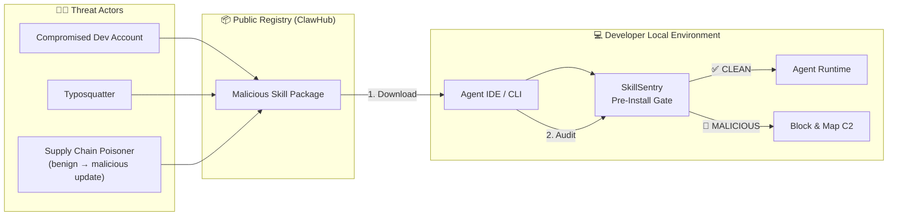
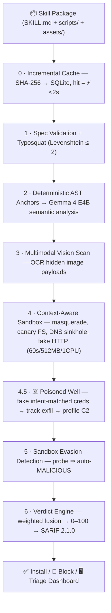

<div align="center">

# 🛡️ SkillSentry

**A Context-Aware Firewall for the Agent Skill Supply Chain with "Poisoned Well" Active Defense**

*Your proprietary skills never leave your machine for auditing. We don't just block attackers; we follow them home.*

  

**⚡ Powered by Gemma 4 · open weights ⚡**

<!-- Record the 30-sec demo GIF during M4 (docs/08-testing-and-evaluation.md §8.7) -->


</div>

---

## 🔎 30-Second Pitch

Agent Skills execute code **and** inject instructions into AI agents — the newest supply-chain attack surface. Snyk's Feb 2026 *ToxicSkills* audit found **~1,467 malicious skills** (prompt injection in **36%** of ClawHub skills examined); the *ClawHavoc* campaign pushed **1,184+ malicious skills** in six weeks. OWASP now lists **AST01 — Malicious Skills** as a formal risk category.

**SkillSentry** audits any skill **before it installs — 100% locally**: Gemma 4 multimodal reasoning (text + vision) fused with deterministic AST anchors and a hardened Docker sandbox featuring **context-aware honeypots**, **sandbox-evasion detection**, and the **☠️ Poisoned Well** — fake, intent-matched credentials that let us catch the thief, decode our canary marker out of their exfil traffic, and map their C2 infrastructure. Clean skills install with zero friction (⚡ < 2 s cached re-scans). Malicious skills are blocked with hard, line-cited evidence and a STIX IOC export.

## 🏴‍☠️ Threat Model



Attack vectors covered: credential theft · image-hidden prompt injection (white-on-white payloads) · typosquatting · tool poisoning · obfuscation (`eval`, base64 bombs) · sandbox evasion · post-install supply-chain poisoning. Full model: [docs/04-security.md](docs/04-security.md).

## 🏗️ Architecture — the 8-Stage Pipeline



| Why it's different | |
|:---|:---|
| **Pre-install + runtime (MCP, Phase 2)** | not just post-install network watching |
| **LLM + Vision + Sandbox + Active Defense** | not just regex/text scanning |
| **Deterministic anchoring** | the LLM cannot contradict hard AST facts — credible, not vibes |
| **Hard-evidence overrides** | canary-marker correlation or evasion probe ⇒ `MALICIOUS`, confidence 1.0 |
| **100% local** | Gemma 4 E4B (Q4) via Ollama; opt-in Gemini API fallback; no telemetry |
| **Fights back** | Poisoned Well deception + C2 tracking + STIX IOC export |

Deep-dives: [Architecture](docs/02-architecture.md) · [Database](docs/03-database.md) · [Security](docs/04-security.md) · [API](docs/05-api-reference.md) · [UI/UX](docs/06-ui-ux.md).

> **Original code:** the sandbox runner, canary filesystem, DNS sinkhole, context-aware honeypot system, sandbox evasion detector, and Poisoned Well correlation engine are original code.

## 🚀 How to Run

Step-by-step install, first scans, reports, dashboard, and troubleshooting: **[docs/16-user-guide.md](docs/16-user-guide.md)**.

**Prereqs:** Python 3.11+ · Node 20+ (to build the dashboard) · Docker (for the sandbox) · [Ollama](https://ollama.com) with the Gemma 4 E4B model.

```bash
# From a checkout (a PyPI release is planned, not yet published)
pip install -e .
cd ui && npm ci && npm run build && cd ..   # builds the dashboard into the package
skill-sentry init                             # writes skillsentry.toml
skill-sentry sandbox build                    # builds the sandbox image (needs Docker)

ollama pull gemma4:e4b-it-qat                # local model used for semantic and vision analysis

skill-sentry scan ./fixtures/benign/pdf-summarizer        # ✅ SAFE
skill-sentry scan ./fixtures/malicious/cloud-sync-pro     # 🚫 MALICIOUS + ☠️ C2 mapped
skill-sentry scan ./fixtures/benign/pdf-summarizer        # ⚡ cached

skill-sentry serve                    # Dashboard → http://127.0.0.1:8000
skill-sentry scan cloud-sync-pro --demo-mode  # offline canned demo (skill names), no Docker or model needed
skill-sentry export <scan_id> --format sarif   # re-render a stored report
skill-sentry cache stats              # inspect the verdict cache
```

**Server image:** `docker build -t skillsentry/server:2.0.0 .` then
`docker run -p 127.0.0.1:8000:8000 skillsentry/server:2.0.0`. The container does not
mount the Docker socket, so the sandbox is unavailable inside it by default. Mounting
`/var/run/docker.sock` gives the container root-equivalent control of the host, so only do
that deliberately.

**Release build and local checks** (CI is blocked while the GitHub account has a billing issue):

```bash
scripts/check.sh          # lint, format, tests, schema drift, demo smoke
scripts/build_release.sh  # dashboard, wheel, and a fresh-venv install check
```

**CI / PR gate (planned):** a `skillsentry/scan` GitHub Action is planned and is not yet published. The intended interface is:

```yaml
- uses: skillsentry/scan@v1   # planned
  with:
    path: ./skills/
    fail-on: suspicious     # the CLI default is suspicious
    upload-sarif: true      # GitHub Security tab
    cache: true             # incremental re-scans
```

Full CLI reference: [docs/07-cli-reference.md](docs/07-cli-reference.md) · Deployment: [docs/09-deployment-and-production.md](docs/09-deployment-and-production.md) (the whole team server fits a **$12 DigitalOcean droplet**).

## 📊 Evaluation (7+1 fixture corpus)

| Skill | Behavior | Expected | Caught by |
|:---|:---|:---|:---|
| `pdf-summarizer` | pure text processing | ✅ SAFE < 30 | — |
| `git-helper` | local git ops | ✅ SAFE < 30 | — |
| `image-resizer` | file ops only | ✅ SAFE < 30 | — |
| `weather-fetch` | **declared** network call | ✅ SAFE < 30 | — (no false positives) |
| `cloud-sync-pro` | steals `~/.aws/credentials` → DNS tunnel | 🚫 MALICIOUS > 90 | Sandbox + ☠️ Poisoned Well |
| `invoice-helper` | white-on-white injection in `logo.png` | 🚫 MALICIOUS > 85 | Gemma 4 Vision (👁 Gemma's Eye View) |
| `slack-notif-mal` | probes `/.dockerenv`, steals Slack token | 🚫 MALICIOUS 100 | Evasion detection + context honeypot |
| `g1t-translate`* | typosquat of `git-translate` | ⚠️ SUSPICIOUS 30–70 | Levenshtein detector |

**Targets:** malicious detection 2/2 (+stretch 3/3) · benign false positives 0/4 · cached re-scan < 2 s · uncached local scan < 90 s · citation accuracy ≥ 80%. Run sheet + metrics methodology: [docs/08-testing-and-evaluation.md](docs/08-testing-and-evaluation.md).

## 📚 Documentation

| Doc | | Doc | |
|:---|:---|:---|:---|
| [Project Overview](docs/01-project-overview.md) | problem, positioning, glossary | [API Reference](docs/05-api-reference.md) | REST/WS, verdict contract v1 |
| [Architecture](docs/02-architecture.md) | 8-stage pipeline, scoring | [UI/UX Design](docs/06-ui-ux.md) | screens, wireframes, UX rules |
| [Database](docs/03-database.md) | SQLite schema, caching | [CLI Reference](docs/07-cli-reference.md) | commands, config, exit codes |
| [Security](docs/04-security.md) | threat model, hardening | [Testing & Evaluation](docs/08-testing-and-evaluation.md) | fixtures, Chaos Run, demo script |
| [Deployment & Production](docs/09-deployment-and-production.md) | pip/Docker/Action, MCP proxy | [Developer Guide](docs/10-developer-guide.md) | setup, contracts, roadmap |
| [Team & Workload](docs/11-team-and-workload.md) | roles, ownership, milestones M0–M5 | | |

Also: [CHANGELOG](docs/CHANGELOG.md) · [CONTRIBUTING](CONTRIBUTING.md) · [SECURITY](SECURITY.md)

## 🙏 Prior Art (honest citations)

- [Snyk — ToxicSkills: malicious AI agent skills on ClawHub](https://snyk.io/blog/toxicskills-malicious-ai-agent-skills-clawhub/)
- Pipelock (OSS runtime network monitoring for agents)
- AIR Security (enterprise cloud AI-agent firewall)
- MCP prompt-injection research (tool poisoning / rug-pull literature)
- [Agent Skill Open Standard](https://agentskills.io/specification) · [Gemma docs](https://ai.google.dev/gemma/docs/core) · [Gemini API](https://ai.google.dev/gemini-api/docs) · [Ollama](https://ollama.com)

## 📄 License

MIT — see [LICENSE](LICENSE). Built by Team SkillSentry — Dev 1 (Backend + AI Integration) · Dev 2 (Backend — Skill Analysis) · Dev 3 (Frontend). Roles & workload: [docs/11-team-and-workload.md](docs/11-team-and-workload.md).

<div align="center">

**⚡ Powered by Gemma 4 · open weights ⚡**

</div>
