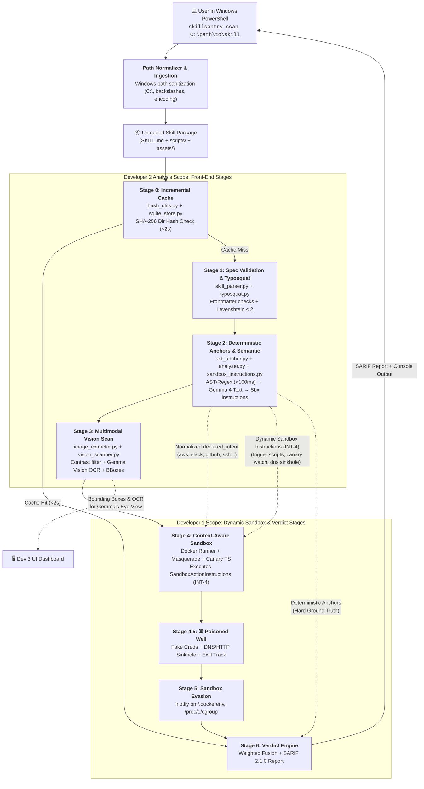
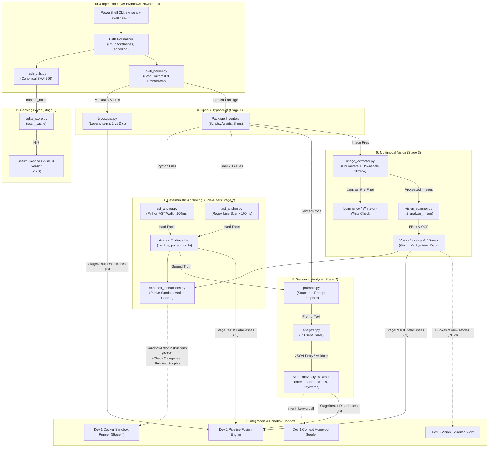
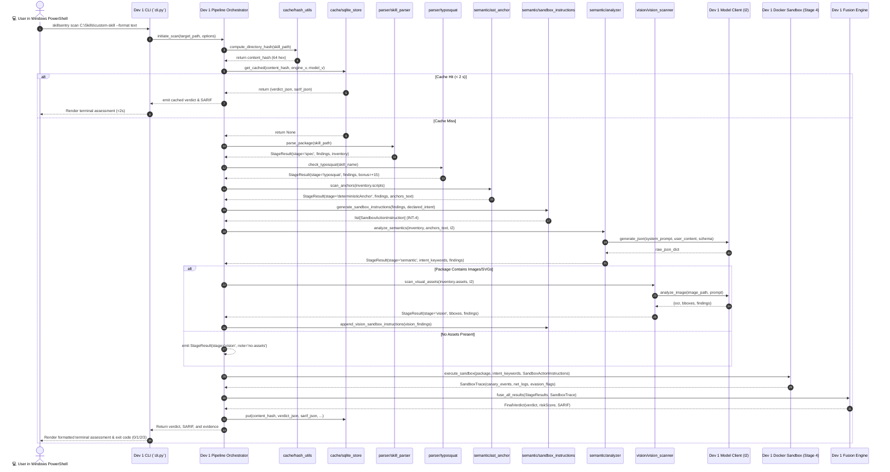

# 02 · Module Architecture & Data Flow

> **Subsystem:** Backend — Skill Analysis  
> **Author:** Developer 2 (Backend Engineer & Security Architect)  
> **Source-of-Truth References:** [docs/02-architecture.md](file:///d:/Skillsentry/SkillSentry/docs/02-architecture.md) · [docs/03-database.md](file:///d:/Skillsentry/SkillSentry/docs/03-database.md) · [docs/04-security.md](file:///d:/Skillsentry/SkillSentry/docs/04-security.md)

---

## 1. System Context & Pipeline Placement

The SkillSentry pipeline is an 8-stage pre-installation analysis engine. Users initiate scans directly from Windows PowerShell using documented CLI commands (`skillsentry scan <path>` or `python -m skillsentry.cli scan <path>`). Developer 2's components are responsible for entry input normalization, safe parsing, deterministic AST anchoring, multimodal vision scanning, caching layers (Stages 0, 1, 2, and 3), and generating **Dynamic Sandbox Action Instructions** (`SandboxActionInstruction`, Interface INT-4) along with normalized intent keywords (`declared_intent`) to drive Developer 1's Stage 4 Docker sandbox.

### 1.1 The 10-Step Windows PowerShell User Workflow
The end-to-end user experience on Windows systems progresses through ten coordinated operational steps:

1. **User Opens PowerShell**: The user opens Windows PowerShell (5.1 or 7.x Core) in a supported terminal (Windows Terminal, VS Code, or ConHost) with Python 3.11+ virtual environment active.
2. **User Invokes Scan**: The user runs the documented command interface:
   ```powershell
   skillsentry scan "C:\path\to\skill" --format text
   ```
3. **Target Specification**: The user specifies a target: a single skill folder, a parent directory of skills, or a relative/absolute/UNC path (including paths with spaces and quotes).
4. **Input Validation & Ingestion**: SkillSentry normalizes backslashes to POSIX slashes, verifies directory containment, validates frontmatter, and checks for reserved Windows DOS device names (`CON`, `PRN`, `AUX`, `NUL`).
5. **Static Analysis & Ingestion Pipeline**: Developer 2 executes Stage 0 (directory hash check) and Stage 1 (spec validation, package inventory, typosquatting analysis).
6. **Model Inference & Embedding Workflow**: On cache miss, Stage 2 executes deterministic AST/regex scanning (<100ms), followed by Gemma 4 semantic intent analysis and embedding generation/reuse; Stage 3 executes image contrast pre-filtering (<50ms) and vision OCR.
7. **Dynamic Sandbox Scheduling & Execution**: Developer 2 emits structured `SandboxActionInstruction` objects. Developer 1's orchestrator schedules and runs the isolated checks within the Stage 4 Docker sandbox container (canaries, DNS sinkhole, fake HTTP responder).
8. **Evidence Correlation & Verdict Fusion**: Developer 1's Stage 6 fusion engine correlates AST anchors, semantic findings, vision payloads, and sandbox canary/sinkhole telemetry into an integrated risk score (0–100) and SARIF 2.1.0 document.
9. **Assessment & Artifact Delivery**: The user receives a color-coded terminal assessment, detailed line-numbered findings, sandbox execution telemetry, and links to exported artifacts (e.g. SARIF report).
10. **Inspection, Remediation & Reproducibility**: The user reviews the findings, understands failures or degraded states, inspects C2 indicators, and can reproduce the scan deterministically (sub-2s cached response on identical input).



---

## 2. Subsystem Component Architecture

Developer 2's subsystem is organized into four core functional domains within `skillsentry/core/`:

```
skillsentry/core/
├── cache/                     # Content Hashing & SQLite Persistence
│   ├── hash_utils.py          # Deterministic directory SHA-256 hasher
│   └── sqlite_store.py        # SQLite repository (scan_cache & schema_meta, <2s budget)
├── parser/                    # Ingestion, Validation & Typosquatting
│   ├── skill_parser.py        # YAML frontmatter, path normalizer & inventory
│   └── typosquat.py           # Levenshtein distance & homoglyph analysis
├── semantic/                  # Code Anchoring & LLM Analysis
│   ├── ast_anchor.py          # Deterministic AST & regex scanner (<100ms)
│   ├── sandbox_instructions.py# Dynamic SandboxActionInstruction generator (INT-4)
│   ├── prompts.py             # Frozen structured prompt contracts
│   └── analyzer.py            # Gemma text analysis coordinator via I2
└── vision/                    # Multimodal Asset Analysis
    ├── image_extractor.py     # Image enumeration, downscaling & contrast filter
    └── vision_scanner.py      # Gemma Vision OCR & bounding-box extractor via I2
```

### 2.1 Detailed Component Interaction Diagram



---

## 3. Data Flow & Execution Sequence

The operational lifecycle of a fresh, uncached skill package proceeding through Developer 2’s stages and downstream sandbox handoff is detailed in the sequence diagram below:



---

## 4. Trust Boundaries & The 5-Phase Sandbox Execution Boundary

Developer 2’s code operates directly on the **untrusted host boundary**. Because SkillSentry is explicitly built to inspect hostile, malicious, and adversarial packages, Developer 2's components must enforce defensive boundaries:

```
[ UNTRUSTED ZONE ]
  Public Registries (ClawHub), Malicious ZIP Archives, Untrusted Folders
  - Hostile SKILL.md (Prompt Injection payloads, instructions to the scanner)
  - Malicious Scripts (Path traversal ../../, bash bombs, eval bombs)
  - Adversarial Images (White-on-white text, stego payloads, oversized SVGs)
        │
        ▼  [ STRICT BOUNDARY CHECKS ]
  1. Safe Directory Walker (Rejects symlinks escaping root, skips .git/__pycache__)
  2. Strict Frontmatter Parser (Max 1024 char desc, BOM/UTF-8 sanitation, depth caps)
  3. Fenced Prompt Data Wrapping (Code wrapped as inert data: --- BEGIN SKILL DATA ---)
  4. AST Anchor Ground-Truth Invariance (Model forbidden from overriding AST facts)
  5. Image Normalization (Downscale to 1024px, PIL decompression bomb protection)
  6. Windows Path Normalization (C:\, backslashes, long-path protection)
        │
        ▼
[ TRUSTED ZONE ]
  Structured `StageResult` Dataclasses, `SandboxActionInstruction` list, SQLite `scan_cache`
```

### 4.1 The 5-Phase Sandbox Execution Boundary

A core architectural principle of SkillSentry is that **Developer 2 detects and instructs, but NEVER executes untrusted code**. The execution lifecycle is partitioned across five distinct phases:

| Phase | Designation | Responsible Subsystem | Concrete Action |
|:---:|:---|:---:|:---|
| **Phase 1** | **Analysis Output** | **Dev 2 (Skill Analysis)** | AST anchors, semantic analysis, and vision OCR detect suspicious patterns. Developer 2 emits findings and packages them into formal `SandboxActionInstruction` objects (target script, reason, check category, normalized intent, suggested limits). |
| **Phase 2** | **Execution Request** | **Dev 1 (Orchestrator)** | The pipeline orchestrator validates scan options (e.g., checks `--no-sandbox` toggle), verifies host prerequisites (Docker daemon status), evaluates policy, and schedules container execution. |
| **Phase 3** | **Sandbox Enforcement** | **Dev 1 (Sandbox Core)** | Docker container runner enforces strict isolation: non-root user, dropped Linux capabilities, 60s hard timeout, 512MB RAM cap, 1 CPU limit, masquerade layer (`/.dockerenv`), and isolated sinkhole network. |
| **Phase 4** | **Sandbox Evidence Collection** | **Dev 1 (Deception/Evasion)** | Kernel `inotify` watches canary paths; DNS sinkhole and fake HTTP responder capture exfiltration traffic; evasion detector watches system probes. Raw telemetry (`canary_events`, `sandbox_net_logs`) is recorded. |
| **Phase 5** | **Evidence Correlation & Verdict** | **Dev 1 (Fusion Engine)** | Fusion engine correlates Phase 4 telemetry with Phase 1 deterministic findings (e.g., matching canary token `SKS-7f3a` to DNS query) and computes the final risk score and SARIF report. |

### 4.2 Boundary Enforcement Rules
1. **Never Execute on Host**: Developer 2's code **never executes** scripts or binaries under audit. All inspection is strictly static (AST parsing, regex line scans, token analysis, image downscaling, vision OCR). Actual execution is quarantined to Developer 1's Docker sandbox in Stage 4. Untrusted code is never run in the PowerShell CLI process.
2. **Never Trust File Paths**: Paths reported in package metadata must be sanitized against path-traversal attacks (`../`, absolute paths, Windows drive letters, symlink redirections).
3. **Never Allow Injection from Scanned Text to Flip Decisions**: Analysis prompts treat all skill text as untrusted data wrapped in delimiters. Model outputs are strictly validated against a hard JSON schema.
4. **Anchor Invariance**: If AST regex detects an `os.system` call or `nslookup`, the model’s claim that *"this skill does not use network or shell"* is automatically flagged as a contradiction and discarded in favor of the anchor.
5. **Fail-Safe Sandbox Handoff**: If sandbox execution is disabled (`--no-sandbox`) or unavailable (Docker down), the orchestrator must flag the verdict as `sandbox-unavailable` (degraded). Developer 2's deterministic code anchors and semantic findings are still preserved in the report.

### 4.3 Sandbox Safety Controls & Isolation Architecture
The execution handoff from Developer 2 to Developer 1 enforces strict defense-in-depth safety controls within the sandbox execution environment:

1. **Host Isolation**: Untrusted skill packages run inside an ephemeral Linux Docker container under a dedicated unprivileged user (`uid=10001, gid=10001`). All Linux capabilities are dropped (`--cap-drop=ALL`), and privileges cannot be escalated (`--security-opt=no-new-privileges`). Root filesystem is mounted read-only (`--read-only`), with ephemeral `tmpfs` mounts for `/tmp` and isolated home directories.
2. **Resource Boundaries & Hard Timeouts**: Container execution is hard-capped at **512 MB RAM**, **1.0 vCPU core**, and a maximum runtime of **60 seconds** (`timeout_s: 60`). If a process hangs, loops infinitely, or attempts fork bombs, the container is forcibly terminated (`SIGKILL`) and recorded as a timeout finding.
3. **Network Isolation & Controlled Simulation**: Public egress to the internet is strictly blocked. All outbound network traffic is routed through an isolated internal bridge to Developer 1's **DNS Sinkhole** (listening on UDP/TCP port 53) and **Fake HTTP Responder** (listening on TCP ports 80 and 443).
4. **Canary Credential Files & Monitoring**: Ephemeral canary files seeded based on Developer 2's `contextual_intent` (e.g., `~/.aws/credentials`, `~/.ssh/id_rsa`, Slack tokens) contain unique tracking markers (`SKS-<hex8>`). Linux kernel `inotify` watches monitor file read attempts in real time.
5. **DNS Sinkhole & Fake HTTP Exfiltration Tracking**: Inbound DNS queries are inspected for Base64 or Hex encoded labels matching canary markers. HTTP POST requests are logged with headers and request payloads to capture exfiltration attempts.
6. **Poisoned Well Correlation & Ephemeral Teardown**: When an exfiltration attempt is confirmed, the sinkhole responds with deceptive secondary payloads to profile the C2 infrastructure. Upon completion of each sandbox check, the container is destroyed, volumes unmounted, and all ephemeral artifacts unlinked.
7. **Failure & Blocked States**: If a package is flagged for host traversal during Stage 1 spec validation, Developer 2 emits `check_status="blocked"` with descriptive `status_notes`, preventing the container from ever mounting or executing the package.

---

## 5. Performance Optimization Architecture & Resource Bounding

To achieve fast, responsive scans without compromising detection thoroughness:

1. **Sub-2-Second Incremental Cache**: Content-addressable SHA-256 caching guarantees instant scan retrieval for unchanged skill packages across runs. SQLite WAL mode provides high concurrency and sub-50ms hash-to-verdict turnaround.
2. **Cheap Deterministic Pre-Filtering**: Fast deterministic checks (AST walk and regex scanning in $<100$ ms; image luminance contrast pre-filter in $<50$ ms) execute before initiating expensive Gemma 4 text and vision inference.
3. **Elimination of Redundant Operations**: File parsing and package inventory are executed once during Stage 1 and shared in-memory via `PackageManifest` across all downstream stages (AST scanning, semantic prompt fencing, asset extraction, and Docker volume mounts).
4. **Embedding Generation, Batching & Reuse**:
   - When generating semantic embeddings for threat clustering, queries are batched in a single model call rather than per-sentence requests.
   - Embeddings are indexed by individual file content hash in SQLite (`scan_cache`), allowing partial reuse when only documentation or non-executable assets are modified.
5. **Bounded Concurrency**: CPU-bound AST scans, image downscaling, and model client queries execute within strict thread/process pool limits (`min(4, os.cpu_count())`) to prevent resource contention on developer laptops.
6. **Persistent Model Connections**: Model client protocol (I2) leverages persistent HTTP keep-alive connections to local Ollama (`localhost:11434`), avoiding per-scan model initialization latency.
7. **Thoroughness Invariance & Fail-Safe Accounting**:
   - Optimizations eliminate duplicate work and execution overhead, but **never omit required detection stages or bypass sandbox checks**.
   - Timeouts and model unavailability are surfaced honestly as degraded findings (`degraded: true`), never as a clean `SAFE` verdict.
   - Fast scan profiles (e.g. `--no-sandbox`) are explicitly documented in the report, preventing unverified claims of clean execution.
