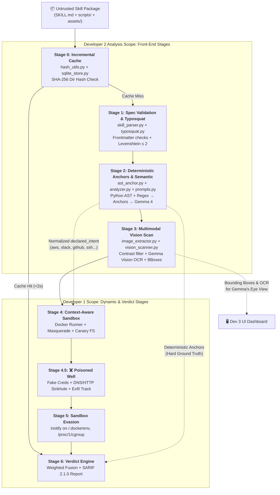
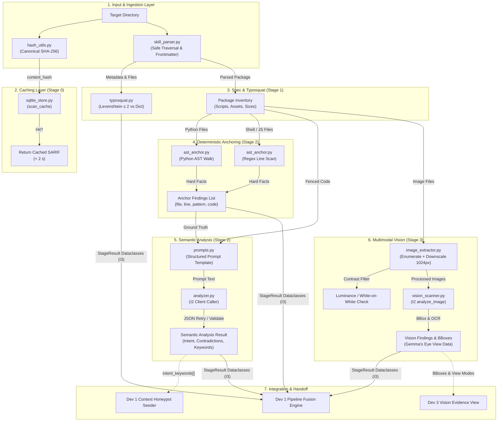
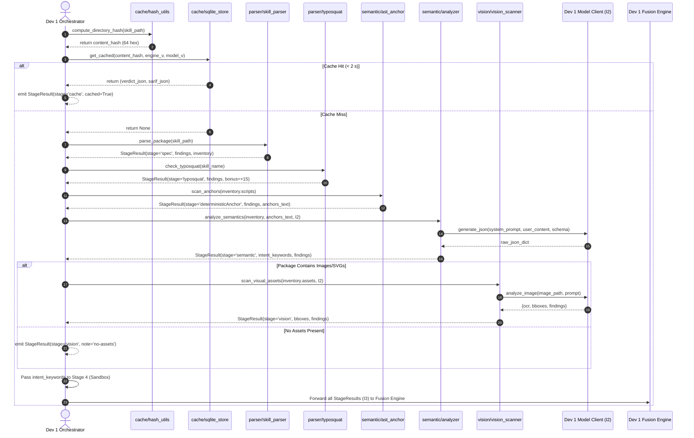

# 02 · Module Architecture & Data Flow

> **Subsystem:** Backend — Skill Analysis  
> **Author:** Developer 2 (Backend Engineer & Security Architect)  
> **Source-of-Truth References:** [docs/02-architecture.md](file:///d:/Skillsentry/SkillSentry/docs/02-architecture.md) · [docs/03-database.md](file:///d:/Skillsentry/SkillSentry/docs/03-database.md) · [docs/04-security.md](file:///d:/Skillsentry/SkillSentry/docs/04-security.md)

---

## 1. System Context & Pipeline Placement

The SkillSentry pipeline is an 8-stage pre-installation analysis engine. Developer 2's components are responsible for the entry, parsing, deterministic anchoring, multimodal scanning, and caching layers (Stages 0, 1, 2, and 3), while also supplying critical baseline data (`declared_intent`) to Developer 1's sandbox honeypots (Stage 4) and evidence records to Developer 3's UI.



---

## 2. Subsystem Component Architecture

Developer 2's subsystem is organized into four core functional domains within `skillsentry/core/`:

```
skillsentry/core/
├── cache/                     # Content Hashing & SQLite Persistence
│   ├── hash_utils.py          # Deterministic directory SHA-256 hasher
│   └── sqlite_store.py        # SQLite repository (scan_cache & schema_meta)
├── parser/                    # Ingestion, Validation & Typosquatting
│   ├── skill_parser.py        # YAML frontmatter & filesystem inventory
│   └── typosquat.py           # Levenshtein distance & homoglyph analysis
├── semantic/                  # Code Anchoring & LLM Analysis
│   ├── ast_anchor.py          # Deterministic AST & regex scanner
│   ├── prompts.py             # Frozen structured prompt contracts
│   └── analyzer.py            # Gemma text analysis coordinator via I2
└── vision/                    # Multimodal Asset Analysis
    ├── image_extractor.py     # Image enumeration, downscaling & contrast filter
    └── vision_scanner.py      # Gemma Vision OCR & bounding-box extractor via I2
```

### 2.1 Detailed Component Interaction Diagram



---

## 3. Data Flow & Execution Sequence

The operational lifecycle of a fresh, uncached skill package proceeding through Developer 2’s stages is detailed in the sequence diagram below:



---

## 4. Trust Boundaries & Security Enclaves

Developer 2’s code operates directly on the **untrusted host boundary**. Because SkillSentry is explicitly built to inspect hostile, malicious, and adversarial packages, Developer 2's components must enforce defensive boundaries:

```
[ UNTRUSTED ZONE ]
  Public Registries (ClawHub), Malicious ZIP Archives, Untrusted Folders
  - Hostile SKILL.md (Prompt Injection payloads, instructions to the scanner)
  - Malicious Scripts (Path traversal ../../, bash bombs, eval bombs)
  - Adversarial Images (White-on-white text, stego payloads, oversized SVGs)
        │
        ▼  [ STRICT BOUNDARY CHECKS ]
  1. Safe Directory Walker (Rejects symlinks escaping root, skips .git/__pycache__)
  2. Strict Frontmatter Parser (Max 1024 char desc, BOM/UTF-8 sanitation, depth caps)
  3. Fenced Prompt Data Wrapping (Code wrapped as inert data: --- BEGIN SKILL DATA ---)
  4. AST Anchor Ground-Truth Invariance (Model forbidden from overriding AST facts)
  5. Image Normalization (Downscale to 1024px, PIL decompression bomb protection)
        │
        ▼
[ TRUSTED ZONE ]
  Structured `StageResult` Dataclasses, Normalized Signals, SQLite `scan_cache`
```

### 4.1 Boundary Enforcement Rules
1. **Never Execute**: Developer 2's code **never executes** scripts or binaries under audit. All inspection is strictly static (AST parsing, regex line scans, token analysis, image downscaling, vision OCR). Actual execution is quarantined to Developer 1's Docker sandbox in Stage 4.
2. **Never Trust File Paths**: Paths reported in package metadata must be sanitized against path-traversal attacks (`../`, absolute paths, symlink redirections).
3. **Never Allow Injection from Scanned Text to Flip Decisions**: Analysis prompts treat all skill text as untrusted data wrapped in delimiters. Model outputs are strictly validated against a hard JSON schema.
4. **Anchor Invariance**: If AST regex detects an `os.system` call or `nslookup`, the model’s claim that *"this skill does not use network or shell"* is automatically flagged as a contradiction and discarded in favor of the anchor.
