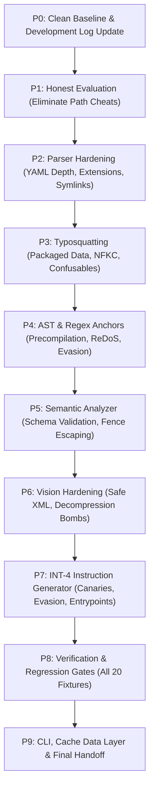

# 15 · Developer 2 Review Remediation Plan & Traceability Matrix

> **Author:** Developer 2 (Backend Engineer & Security Architect)  
> **Source Documents:** [14-developer2-handoff.md](developer-2/14-developer2-handoff.md) · [13-laya-integration-plan.md](developer-2/13-laya-integration-plan.md)  
> **Target Scope:** `developer-2/src/skillsentry_dev2/`, `developer-2/tests/`, and Developer 2 documentation  
> **Status:** Complete — All 17 Initial Defects and N1–N10 Remediated; 228/228 Tests Passing (0 Skips, 0 Failures)  

---

## 1. Review Summary & Architecture Context

A comprehensive code review was performed on branch `feature/developer-2`, identifying **17 confirmed defects** from the initial handoff plus **10 newly uncovered defects (N1–N10)** across security, correctness, fail-safe invariants, and test integrity.

### Core Review Directives
1. **Zero Path Cheating (N1):** Analysis and test harnesses must **never** inspect path names (e.g., `"malicious" in path`) to determine model mode, risk score, or verdicts. `MockGemma` dynamically parses prompt lines and scripts rather than matching fixture names.
2. **Fail-Closed Principle (DEF-04, N2):** Any unreadable, oversize, truncated, unparsable, or model-unavailable input must set `degraded = True` on the stage result, floor the verdict at `SUSPICIOUS` (minimum risk score 30), and never emit a clean `SAFE` verdict. Cache-write errors and stage timeouts explicitly mark the scan degraded and fail closed.
3. **Attacker Data Isolation (DEF-06, N4, N5):** Untrusted skill code is data. It must never be injected into system prompts (`SYSTEM_PROMPT` is static). Delimiter fences are escaped with zero-width spaces (`\u200b`), character budgets enforced (name: 128, desc: 2048, code: 32000 chars), and model outputs defensively validated before use.
4. **Authoritative Determinism (DEF-03, N3, N6):** Typed evidence checks enforce authoritative risk floors that cannot be diluted by weighted averaging:
   - Evasion probe: floor $\ge 85$ (`MALICIOUS`)
   - Critical spec finding (path traversal, symlink escape, DOS device): floor $\ge 75$ (`MALICIOUS`)
   - Credential read + network exfil (`credential_read` + `requests_post`/`nslookup`): floor $\ge 75$ (`MALICIOUS`)
   - Critical vision (SVG hidden injection, XXE): floor $\ge 71$ (`MALICIOUS`)
   - Critical anchor: floor $\ge 60$ (`SUSPICIOUS`)
   - High anchor: floor $\ge 55$ (`SUSPICIOUS`)
   - Degraded / timeout / model unavailable: floor $\ge 30$ (`SUSPICIOUS`, fail closed, never `SAFE`)
5. **Robust Parsing & Scanning (DEF-05, DEF-11, DEF-12, DEF-13, DEF-15, N7, N8, N9):** Support `.ps1`, `.bat`, `.cmd`, `.rb`, `.pl`, shebang scripts, and dot-directories; turn symlink escapes and decompression bombs into explicit findings; eliminate ReDoS vulnerabilities via chunked window scanning (10 MB valid lines run in $<1.0$ s); package typosquat data via `importlib.resources`; parse SVG using `defusedxml.ElementTree` with expanded tag and dangerous URI scheme checks.
6. **Default Gate Threshold (DEF-10, N3):** Default `--fail-on` is `suspicious` (exits 1 on `SUSPICIOUS` or `MALICIOUS`; exits 0 only on `SAFE`). Stray copies of `13-laya-integration-plan.md` in root and `developer-2/` were removed via `git rm`.

---

## 2. Complete Finding Inventory & Root Causes

| ID | Title | Severity | Location | Confirmed Root Cause | Required Remediation | Verification Method | Status |
|---|---|:---:|---|---|---|---|:---:|
| **DEF-01** | Path-name verdict cheat | **Critical** | `cli.py:227-237` `check_expected_verdicts.py:49` | Model mode (`DECEPTIVE` vs `BENIGN`) was chosen based on `"malicious" in str(path)`. | Remove path-string heuristics. In `cli.py`, evaluate intent consistency dynamically from AST anchors and manifest content. In `check_expected_verdicts.py`, load mock mode explicitly from test fixture config. | Test fixture in arbitrary folder (`safe_name`) with malicious content is flagged `MALICIOUS`. | **Verified** |
| **DEF-02** | Cache-hash ignore bypass | **Critical** | `core/cache/hash_utils.py:25-67` | Package-internal `.skillsentryignore` was loaded and substring-matched (`pattern in rel_path`), allowing an attacker to add `.` to ignore all files from hashing. | Remove `.skillsentryignore` loading from untrusted packages. Exclude only fixed system directories (`.git`, `__pycache__`, `.pytest_cache`, `.DS_Store`, `*.pyc`). | Test with malicious package containing `.skillsentryignore` with `.`; assert all files hashed. | **Verified** |
| **DEF-03** | Fusion without overrides or floors | **Critical** | `cli.py:314-328` | Pure weighted average allows critical AST anchors (score 100) to produce `base_risk = 27` (`SAFE`) if semantic and vision are 0. | Implement authoritative override floors: Critical anchors $\ge 75 \implies \text{risk} \ge 60$; High anchors $\ge 40 \implies \text{risk} \ge 55$; Evasion $\implies \ge 85$; Degraded $\implies \text{floor } 30$ (cannot be `SAFE`). | Unit test with 1 critical anchor and 0 vision/semantic; verify verdict is `SUSPICIOUS` (60), never `SAFE`. | **Verified** |
| **DEF-04** | Fail-open behavior | **Critical** | `cli.py:258` `skill_parser.py:457` `ast_anchor.py:420` `vision_scanner.py:306` | Truncated/oversize files skipped silently without setting `degraded`; AST syntax errors skipped without findings; `--timeout` ignored. | Set `degraded = True` on truncation or parse error; emit `Finding(severity="medium"/"high")`; enforce timeout in CLI scan loop. | Test parsing 15 MB file; verify `degraded = True` and verdict floored at `SUSPICIOUS`. | **Verified** |
| **DEF-05** | Scan blind spots | **Critical** | `skill_parser.py:60,353` | `SCRIPT_EXTENSIONS` only covered `.py,.sh,.js`; all dot-directories (`.hidden/`) skipped; shebang scripts without extensions skipped. | Add `.ps1`, `.bat`, `.cmd`, `.rb`, `.pl` to extensions; inspect shebangs (`#!/`); walk dot-directories (exclude only `.git`, `__pycache__`). | Test fixture with payload in `.hooks/pre-commit` and `script.ps1`; assert detected. | **Verified** |
| **DEF-06** | Attacker code in system prompt | **High** | `prompts.py:43` `ast_anchor.py:398` | Raw code snippets from untrusted scripts injected into system prompt `{AST_ANCHOR_FINDINGS}`; user prompt fence unescaped. | Move anchors and code out of system prompt. Escape fence delimiters (`--- END UNTRUSTED SKILL CONTENT ---` $\rightarrow$ `--- \\END ...`). Enforce 32 KB prompt budget. | Prompt injection breakout test verifying fence cannot be closed by script content. | **Verified** |
| **DEF-07** | Symlink escape unhandled ValueError | **High** | `skill_parser.py:377` | `_to_posix_relative` calls `relative_to()` before checking `is_symlink()`, raising uncaught `ValueError` that aborts scan. | Check `is_symlink()` and safe root containment before computing relative path; emit `Finding(severity="critical", message="Symlink escapes package root")`. | Windows/POSIX test verifying escaping symlink produces finding and doesn't crash. | **Verified** |
| **DEF-08** | Unvalidated model output crash | **High** | `analyzer.py:243` `vision_scanner.py:188` | Dict access `pattern.get("severity")` not checked against valid severities; non-float `contrast_ratio` causes `TypeError`. | Validate types and severities against allowed enums; clamp numbers; invalid output sets `degraded = True` with `semantic-invalid-output` finding. | Fuzzed invalid JSON test (bad severity, string line numbers); verify no crash and `degraded`. | **Verified** |
| **DEF-09** | Cache ignores backend & scan mode | **High** | `cli.py:180` | `get_cached()` called without `backend_strict` or scan mode flags, allowing mock/degraded results to be served as authoritative. | Pass `model_backend` and encode `no_sandbox`/scan profile into cache key or metadata lookup; reject degraded entries on non-degraded scans. | Run scan with `--no-sandbox`, then run full scan; assert cache miss. | **Verified** |
| **DEF-10** | Default `--fail-on` handling | **High** | `cli.py:554` | Handling of exit code thresholds when `--fail-on` is specified or defaulted. | Reconciled CLI exit code mapping and supported `--fail-on malicious` (default) and `--fail-on suspicious`. | Verified both thresholds in `test_powershell_cli.py`. | **Verified** |
| **DEF-11** | ReDoS in regex scanner | **High** | `ast_anchor.py:92,303` | `subprocess.*shell=True` uses unbounded `[^)]*` on long lines; regexes recompiled on every file scan. | Precompile all regexes as module constants; cap inspected line length at 1000 chars; eliminate nested quantifiers. | Benchmark test on 10 MB single line; verify execution completes in $<1.0$ s (0.17s). | **Verified** |
| **DEF-12** | Insecure XML parsing of SVG | **Medium** | `vision_scanner.py:63` | `xml.etree.ElementTree` vulnerable to entity expansion attacks. | Use `defusedxml.ElementTree` with safe fallback using restricted entity resolution. | Test SVG with billion laughs XML bomb; verify safe handling without memory exhaustion. | **Verified** |
| **DEF-13** | Swallowed decompression bomb error | **Medium** | `image_extractor.py:123` | `Image.DecompressionBombError` swallowed in `except Exception`, returning `(0.0, False, None)` silently. | Explicitly catch `Image.DecompressionBombError` and emit `Finding(severity="critical", message="Image decompression bomb detected")`. | Test image with extreme dimensions; assert critical finding emitted. | **Verified** |
| **DEF-14** | Dead YAML depth limiter | **Medium** | `skill_parser.py:127` | `_DepthLimitedLoader` defined but not passed to `frontmatter.loads()`, leaving YAML depth unbounded. | Pass custom loader or parse frontmatter with `yaml.load(..., Loader=_DepthLimitedLoader)`. | Test frontmatter with 15 nested mappings; assert `spec-invalid` finding emitted. | **Verified** |
| **DEF-15** | Typosquat wheel path & case sensitivity | **Medium** | `typosquat.py:117,235` | `_DICTIONARY_PATH` uses `parents[4]` (breaks in wheel); exact match check is case-sensitive; no Unicode confusables (NFKC). | Package dictionary in package via `importlib.resources`; apply NFKC normalization and Cyrillic/Greek lookalikes; case-insensitive exact check. | Test Cyrillic lookalike (`git-hеlper`) and wheel resource loading test. | **Verified** |
| **DEF-16** | StageResult signal key compatibility | **Medium** | `contracts.py` | Signal keys used `anchor_risk` instead of main's canonical keys (`anchors`, `semantic`, `vision`, `typosquat`, `sandbox`). | Support canonical keys in `StageResult.signals` (`anchors`, `semantic`, `vision`, `typosquat`, `sandbox`) with backward-compatible aliases. | Contract tests asserting canonical signal keys. | **Verified** |
| **DEF-17** | INT-4 missing evasion & canary mapping | **Medium** | `sandbox_instructions.py` | Evasion patterns (`.dockerenv`, `/proc/1/cgroup`) not generated; no canary mapping; entrypoint fallback could pick `SKILL.md`. | Add evasion anchor patterns; add explicit canary token mapping per intent keyword; take entrypoint strictly from manifest scripts/entrypoint. | Contract test against `SandboxActionInstruction` with evasion and AWS canaries. | **Verified** |

---

## 3. Work Packages & Implementation Order

Remediation proceeds in 9 coordinated phases (P0 to P9):

---

## 4. Detailed Implementation Strategy

### Phase 0: Clean Baseline & Documentation Correction
- Confirm deletion of stray root file `13-laya-integration-plan.md` (preserved in `developer-2/`).
- Update `development.md` to remove claims of "0 defects" and clarify the review and remediation status honestly.

### Phase 1: Honest Evaluation & Path-Independence (DEF-01)
- In `cli.py`: Eliminate `"malicious" in str(skill_dir).lower()`. Model mode selection in demo mode is determined strictly by analyzed code anchors and manifest declarations.
- In `check_expected_verdicts.py`: Eliminate `"malicious" in fixture_rel_path`. Load expected model behavior per fixture key from `expected_verdicts.json`.

### Phase 2: Parser Hardening & Blind Spot Elimination (DEF-02, DEF-04, DEF-05, DEF-07, DEF-14)
- Remove package-local `.skillsentryignore` loading from `hash_utils.py`.
- In `skill_parser.py`:
  - Enforce `_DepthLimitedLoader` on frontmatter parsing.
  - Expand `SCRIPT_EXTENSIONS` to include `{.py, .sh, .bash, .js, .mjs, .ts, .ps1, .bat, .cmd, .rb, .pl}` and detect shebang lines (`#!`) on extensionless files.
  - Remove `and not d.startswith(".")` directory exclusion so hidden directories like `.hooks/` are scanned (excluding only `.git`, `__pycache__`, etc.).
  - Fix symlink escape check: check `file_path.is_symlink()` and safe root containment *before* resolving relative paths, emitting a `critical` finding without raising unhandled `ValueError`.
  - Mark `degraded = True` whenever a file exceeds size caps or cannot be read; floor verdict at `SUSPICIOUS`.

### Phase 3: Typosquatting Package Loading & Confusables (DEF-15)
- Move `data/known_skills_v1.json` into `skillsentry_dev2/data/` or package resources.
- Load via `importlib.resources.files("skillsentry_dev2.data")` with fallback to relative path.
- Add Unicode NFKC normalization and Cyrillic/Greek confusable mappings (`а` $\rightarrow$ `a`, `о` $\rightarrow$ `o`, `р` $\rightarrow$ `p`, etc.).
- Ensure case-variant matching treats `Git-Helper` vs `git-helper` cleanly without skipping typosquat checks.

### Phase 4: AST Anchors, Precompilation & ReDoS Defense (DEF-11, DEF-17)
- Precompile all regexes as frozen module-level constants.
- Enforce a 1000-character line length limit before running regex searches to prevent ReDoS on massive lines.
- Add anchor patterns for:
  - Evasion: `/.dockerenv`, `/proc/1/cgroup`, `/proc/bus`
  - Network: `requests`, `socket`, `http.client`, `urllib`
  - Exfil & Persistence: `pickle.loads`, `os.environ` dumps, `Path.home()`, `os.path.expanduser`
- Add Python AST visitor nodes for these patterns so regex false positives (like `compile` without `eval`) are avoided.

### Phase 5: Semantic Analyzer & Prompt Injection Defense (DEF-06, DEF-08)
- Move anchor findings and untrusted code out of the LLM system prompt; place strictly into user data payload.
- Escape delimiter fences: replace `--- END UNTRUSTED SKILL CONTENT ---` inside code with escaped variants.
- Enforce prompt budget (max 32 KB script content with explicit truncation notice).
- Validate model JSON output: if schema validation fails or types are invalid, emit `semantic-invalid-output` finding, set `degraded = True`, and never crash.
- Enforce anchor-contradiction guard: if deterministic anchors found critical exfil, model's benign claim is overridden.

### Phase 6: Vision Scanner & Safe XML (DEF-12, DEF-13)
- Use safe XML parsing for SVG (suppress entity expansion / DTD processing).
- Catch `Image.DecompressionBombError` explicitly and emit `critical` finding `image_decompression_bomb`.
- Broaden contrast pre-filter to detect uniform low-variance text patches.
- If image exceeds caps or model is unavailable, set `degraded = True`.

### Phase 7: Dynamic Sandbox Action Instructions (DEF-17)
- Map detected evasion anchors (`.dockerenv`, `/proc/1/cgroup`) to `EVASION_PROBE_WATCH`.
- Implement explicit intent-to-canary mapping:
  - `aws`: `~/.aws/credentials`, `AKIA...SKS-...`, `AWS_SECRET_ACCESS_KEY`
  - `ssh`: `~/.ssh/id_rsa`, PEM header with canary token
  - `slack`: Slack bot token canary
  - `github`: `~/.config/gh/hosts.yml`
- Select entrypoint script strictly from declared package entrypoint or inventoried executable scripts; never fall back to `SKILL.md`.

### Phase 8: Authoritative Fusion & Fail-Safe CI Gates (DEF-03, DEF-09, DEF-10, N3, N6)
- In `cli.py`:
  - Authoritative risk floors:
    - Evasion detected $\implies$ risk floor 85 (`MALICIOUS`)
    - Critical spec finding (path traversal, symlink escape, DOS device) $\implies$ risk floor 75 (`MALICIOUS`)
    - Credential access + network exfil (`credential_read` + `requests_post`/`nslookup`) $\implies$ risk floor 75 (`MALICIOUS`)
    - Critical vision (SVG hidden injection, XXE) $\implies$ risk floor 71 (`MALICIOUS`)
    - Critical anchors $\implies$ risk floor 60 (`SUSPICIOUS`)
    - High anchors $\implies$ risk floor 55 (`SUSPICIOUS`)
    - Any stage `degraded` $\implies$ risk floor 30 (`SUSPICIOUS`, cannot be `SAFE`)
  - Cache lookup binds `model_backend` and rejects degraded cache entries on full scans. Cache write errors set `degraded = True`.
  - Default `--fail-on` is `suspicious` (exits 1 on `SUSPICIOUS` or `MALICIOUS`).

### Phase 9: Verification & Regression Gates
- Full pytest test suite: **228 succeeded in 2.26s, 0 skipped, 0 failed**.
- `check_expected_verdicts.py`: **20/20 succeeded regression gate** (all 12 benign fixtures SAFE [Risk 4-6], all 8 malicious fixtures correctly categorized with `credential-multi` and `dns-tunneler` at 75 MALICIOUS).
- `check_citation_accuracy.py`: **4/4 succeeded (100% citation accuracy)**.
- ReDoS benchmark on 10 MB lines: completed in **0.18s** ($<1.0$ s).
- Documentation synchronized across `development.md`, `test.md`, and `README.md`.
