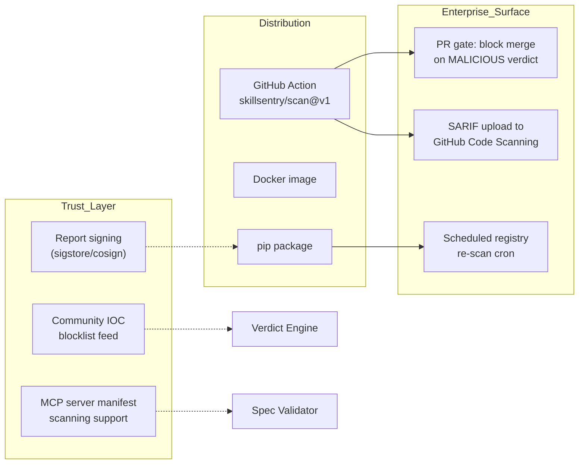
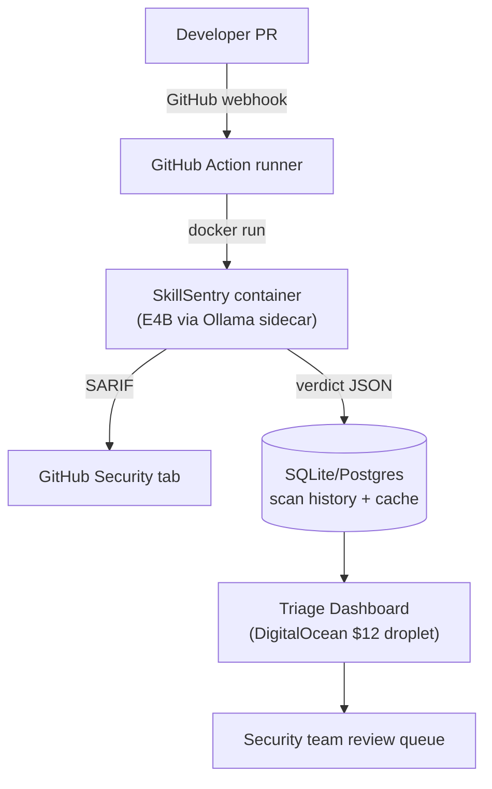
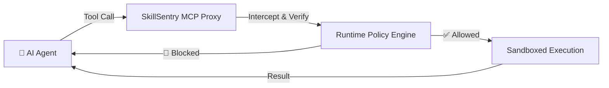

# 9 · Deployment & Production

> Distribution surfaces, the GitHub Action (shift-left PR gate), self-hosted team-server topology, Phase-2 MCP runtime interception, production hardening, observability, and operations.

---

## 9.1 Distribution Surfaces



| Surface | Audience | Notes |
|:---|:---|:---|
| `pip install skill-sentry-cli` | Individual devs, local CLI | Pulls core + CLI; UI served via `skill-sentry-cli serve` |
| Docker image | CI runners, team servers | Includes sinkhole responder components; needs Docker-in-Docker or socket mount for the sandbox stage (documented trade-off; socket mount guarded by `no-new-privileges` guidance) |
| GitHub Action `skillsentry/scan@v1` | Teams / OSS maintainers | PR gate + SARIF upload + cron re-scans |

## 9.2 Local Deployment (developer machine)

A step-by-step guide for a new machine is in [16-user-guide.md](16-user-guide.md).

**Requirements:** 8 GB+ RAM recommended (a local model at Q4, plus the Docker sandbox), ~10 GB disk for the model, Docker daemon, Python 3.11+.

```bash
ollama pull gemma4:e4b-it-qat        # pre-cache the model (do this the night before demos)
pip install -e .                  # from a checkout; not yet published to PyPI
skill-sentry-cli init                  # writes skillsentry.toml
skill-sentry-cli scan ./my-skill       # first run: full pipeline (<90 s target)
skill-sentry-cli scan ./my-skill       # second run: ⚡ cached (<2 s)
skill-sentry-cli serve                 # dashboard at http://127.0.0.1:8000
```

Performance expectations: uncached local scan **< 90 s**/skill (E4B Q4); cached **< 2 s**; vision images downscaled to 1024 px to hold the budget.

## 9.3 GitHub Action — the B2B "shift-left" story

```yaml
# consumer's .github/workflows/skill-audit.yml
- uses: skillsentry/scan@v1
  with:
    path: ./skills/
    fail-on: malicious        # blocks PR merge
    upload-sarif: true        # appears in GitHub Security tab
    model: gemma-4-e4b-local  # or gemini-api
    cache: true               # enable incremental scanning
```

| Input | Values | Behavior |
|:---|:---|:---|
| `path` | directory glob | Scans every skill folder beneath it |
| `fail-on` | `malicious` (default) / `suspicious` | Maps to CLI exit code 1 ⇒ PR check fails |
| `upload-sarif` | bool | Uploads SARIF via `github/codeql-action/upload-sarif` ⇒ findings in the Security tab |
| `model` | `gemma-4-e4b-local` / `gemini-api` | Runner-local Ollama sidecar vs. cloud |
| `cache` | bool | Persers/restores `~/.skillsentry/skillsentry.db` via `actions/cache` keyed on skill content hashes ⇒ PR re-scans are instant for unchanged skills |

**Scheduled registry re-scan:** the same action on a `cron:` schedule re-hashes installed skills; because the cache key is the *content hash*, a supply-chain poisoning update (benign → malicious) is a guaranteed cache miss and full re-audit.

## 9.4 Self-Hosted Team Server



- Runners execute scans (sandbox stages included); verdicts + SARIF flow to a central store (Postgres variant of the schema, [03-database.md](03-database.md) §3.9) and to GitHub's Security tab.
- The dashboard is read-only over the scan DB: triage queue, confirmed-IOC leaderboard, cache hit-rate, verdict distribution.
- **DigitalOcean sponsor angle:** the entire team-server runs on a single **$12 droplet** (dashboard + Postgres; heavy inference stays on runners or an Ollama sidecar host) — mirror this in the README.

## 9.5 Phase 2 — MCP Runtime Interception

SkillSentry transitions from pre-install scanner to **MCP proxy** for runtime protection:



**Why:** pre-install auditing catches static threats; runtime interception catches **dynamic privilege escalation** — *"You were approved to read files, but you just tried to open a network socket. Blocked."*

**Runtime guards:**

| Guard | Policy source | Action on violation |
|:---|:---|:---|
| Permission check (file read vs network) | Pre-install verdict's declared capabilities | Block call, log, notify agent |
| Resource limits (CPU, memory, time) | Global + per-skill quotas | Throttle/kill |
| Behavioral drift (declared vs actual) | `declared_intent` from Stage 2 vs. observed tool calls | Block + re-scan trigger |

Deployment: sidecar process between agent and MCP servers; configuration via the same `skillsentry.toml`; blocked calls emit the same finding schema (stage `runtime`) into the scan DB.

## 9.6 Production Hardening Checklist (plan §12.5)

- ☐ **Sandbox escape hardening:** `--security-opt no-new-privileges`, seccomp default profile, non-root user (see [04-security.md](04-security.md) §4.5)
- ☐ **Scan timeout watchdog** + per-skill resource quotas
- ☐ **Structured logging (JSON)** + OpenTelemetry hooks
- ☐ **Signed verdicts:** sigstore keyless signing, verifiable via `cosign verify-blob`
- ☐ **Versioned verdict schema** with migration path
- ☐ **Signed release tags** + CHANGELOG + `SECURITY.md`
- ☐ **Community IOC blocklist:** simple signed JSON feed, opt-in, with false-positive dispute process
- ☐ **MCP runtime proxy:** permission enforcement, behavioral drift detection

## 9.7 Observability — Spec (proposed)

| Signal | Metric/event |
|:---|:---|
| Scan throughput | `skillsentry_scans_total{verdict}`, `skillsentry_scan_duration_seconds` histogram |
| Cache effectiveness | `skillsentry_cache_hits_total / lookups_total` (target: > 80% on re-scan workloads) |
| Stage health | Per-stage latency + error rate (`semantic_unavailable`, `sandbox_unavailable`, …) |
| Deception activity | `poisoned_well_correlations_total`, `evasion_probes_total`, unique confirmed IOCs |
| Model backend | Active backend, fallback events, inference latency |

Logs are JSON lines with `scan_id` correlation; no skill content in logs by default (paths and hashes only) — evidence lives in the DB/reports.

## 9.8 Operations Runbook (essentials)

| Task | Procedure |
|:---|:---|
| Backup | Snapshot `~/.skillsentry/skillsentry.db` (+ `reports/`); SQLite WAL checkpoint first (`.backup` command) |
| Upgrade | Pull new version → `engine_version` bump automatically invalidates cache → re-scan critical skills; DB migrations apply forward-only; newer-schema DBs refuse to open on older binaries (fail closed) |
| Model update | Pin `model_version`; run fixture regression (§8.1 policy) before promoting; `--no-cache` A/B on 3 fixtures for latency |
| Stuck sandbox | Watchdog kills at 60 s; manual: `docker ps --filter label=skillsentry` → `docker rm -f` |
| False positive dispute | Re-run with `--no-cache --backend cloud` for a second opinion; if still wrong, file issue with SARIF attached; weights are config-tunable |
| Incident (real C2 confirmed) | Export STIX bundle → hand to security team → optionally contribute IOCs to community feed (opt-in) |

---

*Next: [10-developer-guide.md](10-developer-guide.md).*
