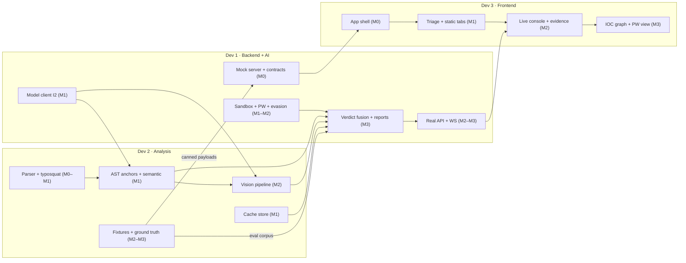

# 11 · Team & Workload Assignment

> **Authoritative role and workload split for SkillSentry v2.0.** This document supersedes the plan's original team division (Frontend / Backend-Systems / Backend-Agentic-AI) and the ownership tables previously shown in [10-developer-guide.md](10-developer-guide.md) §10.2–10.5.

---

## 11.1 Roles at a Glance

| Role | Person | Scope (one-liner) |
|:---|:---|:---|
| **Dev 1 · Backend + AI Integration** | Project initiator ("me") | Sandbox for skill testing, Poisoned Well deception, evasion detection, model plumbing (Ollama/Gemini), verdict fusion + **report generation**, API server/orchestrator |
| **Dev 2 · Backend (Skill Analysis)** | Backend dev #2 | Detecting **malicious instructions in skills**: parser/spec/typosquat, AST anchors, semantic analysis, vision pipeline, cache store, analysis fixtures |
| **Dev 3 · Frontend (only)** | Frontend dev | The complete React dashboard (`ui/`) + demo assets (GIF, backup video). **No backend code, no fixtures.** |

### Decision log (clarifications resolved)

| # | Decision | Rationale |
|:--|:---|:---|
| D1 | **Dev 2 owns analysis logic; Dev 1 owns model plumbing.** `ast_anchor`, `analyzer`, `prompts`, `vision_scanner` → Dev 2. `gemma_local` / `gemma_cloud` clients → Dev 1, consumed by Dev 2 as a library. | Keeps "find malicious instructions" in one head; keeps "talk to Gemma" in one head. Clean interface (I2, §11.6). |
| D2 | **Dev 1 owns the pipeline orchestrator + FastAPI server + WS + `demo_mode`.** | Verdict fusion/report generation is Dev 1's anyway; Dev 1 ships the mock server in M0 so Dev 3 is never blocked. |
| D3 | **Milestone-based schedule (M0–M5), no fixed hours.** | Longer timeline than a single hackathon day; milestones have entry/exit criteria instead of hour slots. |
| D4 | **Dev 1 sequence: sandbox first → report generation after** (per Dev 1's stated priority), with one small M0 exception: contracts + mock server ship first because Dev 3 depends on them. | Explicit team instruction. |
| D5 | **`core/cache/` store implementation → Dev 2** (interface consumed by Dev 1's orchestrator/verdict engine). | Load balancing — Dev 1's surface is the largest (see §11.8). |

## 11.2 Module Ownership Map

Owner tags on the repository tree (full annotated structure: [02-architecture.md](02-architecture.md) §2.6):

```text
skill_sentry/
 ├── pyproject.toml                     [D1]  (D2 reviews deps)
 ├── skill_sentry/
 │   ├── cli.py                         [D1]  scan orchestration, exit codes
 │   ├── core/
 │   │   ├── cache/
 │   │   │   ├── sqlite_store.py        [D2]  scan_cache table + repository interface
 │   │   │   └── hash_utils.py          [D2]  directory SHA-256 (docs/03 §3.2)
 │   │   ├── parser/
 │   │   │   ├── skill_parser.py        [D2]  SKILL.md + frontmatter
 │   │   │   └── typosquat.py           [D2]  Levenshtein ≤ 2
 │   │   ├── semantic/
 │   │   │   ├── ast_anchor.py          [D2]  deterministic regex/AST pre-scan
 │   │   │   ├── analyzer.py            [D2]  orchestrates Gemma via I2 client
 │   │   │   └── prompts.py             [D2]  frozen prompt templates
 │   │   ├── vision/
 │   │   │   ├── image_extractor.py     [D2]
 │   │   │   └── vision_scanner.py      [D2]  OCR + bbox via I2 client
 │   │   ├── sandbox/
 │   │   │   ├── runner.py              [D1]  Docker lifecycle + limits + teardown
 │   │   │   ├── masquerade.py          [D1]  hide /.dockerenv, /proc/1/cgroup, LD_PRELOAD
 │   │   │   ├── context_honeypot.py    [D1]  intent-aware seeding
 │   │   │   ├── canary_fs.py           [D1]
 │   │   │   ├── dns_sinkhole.py        [D1]
 │   │   │   ├── fake_http.py           [D1]  200 OK + secondary canary
 │   │   │   └── monitor.py             [D1]  inotify + env-read tracker
 │   │   ├── poisoned_well/
 │   │   │   ├── canary_gen.py          [D1]  SKS-<8hex> markers
 │   │   │   ├── exfil_tracker.py       [D1]  raw/base64/hex/subdomain correlation
 │   │   │   └── attacker_profile.py    [D1]  IOC builder (+ STIX writer: swing task §11.8)
 │   │   ├── evasion/
 │   │   │   └── detector.py            [D1]
 │   │   ├── verdict/
 │   │   │   ├── fusion.py              [D1]  weights + overrides
 │   │   │   └── sarif_report.py        [D1]  SARIF + Markdown (+ STIX: swing task)
 │   │   └── models/
 │   │       ├── gemma_local.py         [D1]  Ollama client (library for D2)
 │   │       └── gemma_cloud.py         [D1]  Gemini API fallback (swing task)
 │   ├── server/
 │   │   ├── app.py                     [D1]  FastAPI + WS
 │   │   ├── routes.py                  [D1]
 │   │   └── demo_mode.py               [D1]  (canned payloads contributed by D2 from fixtures)
 │   └── skill/                         [D1]  own SKILL.md + scripts/audit.sh (already drafted)
 ├── ui/                                [D3]  everything frontend
 ├── fixtures/
 │   ├── benign/  (×4)                  [D2]  pdf-summarizer, git-helper, image-resizer, weather-fetch
 │   └── malicious/
 │       ├── cloud-sync-pro/            [D1]  (exercises D1's sandbox + Poisoned Well)
 │       ├── slack-notif-mal/           [D1]  (exercises evasion + context honeypot)
 │       ├── invoice-helper/            [D2]  (exercises D2's vision pipeline)
 │       └── g1t-translate/             [D2]  (exercises D2's typosquat detector)
 └── tests/                             each dev owns tests for their modules;
                                        contract tests [shared, D1 hosts]
```

**Database table ownership** ([03-database.md](03-database.md)): `scan_cache` + migrations infra → **D2**; `scans`, `findings`, `active_defense`, `canary_events`, `sandbox_net_logs`, `iocs`, `attacker_profiles` → **D1**.

## 11.3 Work Packages per Developer

### Dev 1 — Backend + AI Integration

Personal sequence per D4: **sandbox → deception → model plumbing → report generation → server E2E** (mock server pulled forward into M0 because Dev 3 depends on it).

| WP | Deliverables | Milestone |
|:---|:---|:---|
| **W1.0 Contracts & mock** | Frozen Verdict JSON v1 + stage identifiers + WS event schema (shared constants module); `demo_mode.py` serving canned verdicts + WS replay; repo/CI scaffold | M0 |
| **W1.1 Sandbox core** | `runner.py` (60 s / 512 MB / 1 CPU, guaranteed teardown), `masquerade.py`, `canary_fs.py`, `context_honeypot.py` (intent → canary set, §2.3 of arch doc), `monitor.py` (inotify) | M1 |
| **W1.2 Model plumbing** | `gemma_local.py` (Ollama) exposing interface **I2**; `gemma_cloud.py` fallback wiring; backend selector `auto/local/cloud/demo` | M1 |
| **W1.3 Deception & evasion** | `dns_sinkhole.py`, `fake_http.py` (200 + secondary canary), `exfil_tracker.py` correlation engine, `attacker_profile.py`, `evasion/detector.py`; telemetry tables | M2 |
| **W1.4 Verdict + report generation** | `fusion.py` (weights + overrides), `sarif_report.py` (SARIF 2.1.0 + `activeDefense` extension, Markdown, STIX), cache consumption/writes, orchestrator E2E, CLI exit-code contract | M3 |
| **W1.5 Server & streaming** | `app.py` / `routes.py` real pipeline behind the M0 contract; WS live events with ≤ 2 s heartbeat; export endpoints; `self-audit` | M2–M3 |
| **W1.6 Fixtures** | `cloud-sync-pro`, `slack-notif-mal` (+ safety rules, [08-testing-and-evaluation.md](08-testing-and-evaluation.md) §8.2) | M2 |

### Dev 2 — Backend (Skill Analysis)

Mission: **find malicious instructions in skills** — every static, semantic, and visual detection stage.

| WP | Deliverables | Milestone |
|:---|:---|:---|
| **W2.1 Parser & spec** | `skill_parser.py` (frontmatter, size caps, path-traversal rejection), `typosquat.py` (Levenshtein ≤ 2 + known-names dictionary) | M0–M1 |
| **W2.2 Deterministic anchors** | `ast_anchor.py` — full pattern list (arch doc §2.3), `{file, line, pattern, description, code}` findings | M1 |
| **W2.3 Semantic analysis** | `prompts.py` (frozen template with anchors-as-ground-truth), `analyzer.py` (strict-JSON, one retry, `semantic-unavailable` on failure) against **I2** — mock Ollama first, real model when W1.2 lands | M1 |
| **W2.4 Vision pipeline** | `image_extractor.py`, `vision_scanner.py` (1024 px downscale, OCR, bbox for Gemma's Eye View, SVG text + rendered) | M2 |
| **W2.5 Cache store** | `hash_utils.py` (docs/03 §3.2 spec), `sqlite_store.py` (repository interface: `get_cached/put/prune`), invalidation on engine/model version, migrations infra | M1 |
| **W2.6 Fixtures & ground truth** | 4 benign + `invoice-helper` (white-on-white payload image) + `g1t-translate`; hand-annotated ground-truth lines; `tests/expected_verdicts.json`; citation-accuracy harness | M2–M3 |
| **W2.7 Eval measurement** | Run the eval sheet ([08-testing-and-evaluation.md](08-testing-and-evaluation.md) §8.4), produce README metrics table, regression gate in CI | M3–M4 |

### Dev 3 — Frontend (only)

Builds against Dev 1's mock server from day one; switches to the real API by base URL only.

| WP | Deliverables | Milestone |
|:---|:---|:---|
| **W3.1 App shell** | Vite + TS + Tailwind + shadcn scaffold, routing, `<Header>` with Gemma badge + backend toggle, design tokens ([06-ui-ux.md](06-ui-ux.md) §6.1) | M0 |
| **W3.2 Triage table** | Verdict pills, Recharts risk gauges, ⚡ cache indicator, key-finding column, filters/sort/export buttons, install gating rules (UX rule 8) | M1 |
| **W3.3 Evidence tabs I** | Static Findings (code viewer, red line highlights, `file:line` links), contract types generated from Verdict v1 | M1–M2 |
| **W3.4 Live console** | WS terminal view, per-stage progress, heartbeat handling, degraded-mode banner from `GET /health` | M2 |
| **W3.5 Evidence tabs II** | Sandbox Trace timeline, Vision Evidence with Normal/Contrast/**Gemma's Eye View** bbox overlay | M2 |
| **W3.6 Poisoned Well view** | Attack timeline (live WS rows) + React Flow IOC graph + context banner + STIX export button | M3 |
| **W3.7 States, a11y, demo** | Empty/loading/error states everywhere, WCAG passes (§6.6), `DEMO DATA` chip, settings | M3–M4 |
| **W3.8 Demo assets** | README GIF capture, backup demo video (unlisted), demo-mode rehearsal support | M4 |

## 11.4 Milestones (entry/exit criteria — no fixed hours)

| Milestone | Dev 1 | Dev 2 | Dev 3 | Exit criteria |
|:---|:---|:---|:---|:---|
| **M0 · Contracts & Scaffold** | W1.0 (contracts, mock server, CI) | W2.1 parser skeleton; benign fixture drafts | W3.1 shell rendering canned triage rows | Verdict v1 frozen in shared constants; mock server streams canned WS; CI runs unit + contract tests; all three devs unblocked without each other's live code |
| **M1 · Sandbox Base + Deterministic Analysis** | W1.1 sandbox core; W1.2 model client **I2 delivered** | W2.1–W2.3, W2.5 complete | W3.2, W3.3 | Benign fixture executes in sandbox with zero canary/probe triggers; anchors + semantic emit schema-valid JSON (mock then real model); cache round-trip < 2 s; triage table correct against mock |
| **M2 · Deception, Vision, Live Pipeline** | W1.3 sinkhole/PW/evasion; W1.5 real WS streaming; W1.6 fixtures | W2.4 vision pipeline; W2.6 fixtures complete | W3.4, W3.5 | `cloud-sync-pro` ⇒ PW correlation confirmed E2E; `slack-notif-mal` ⇒ evasion auto-fail; `invoice-helper` ⇒ vision finding with bbox; live console on real WS |
| **M3 · Verdict, Reports, E2E** | W1.4 fusion + SARIF/Markdown/STIX + cache writes + orchestrator E2E | W2.6 ground truth + W2.7 eval harness; citation tuning | W3.6, W3.7 | Full eval sheet (§8.4) meets targets: 3/3 malicious, 0/4 FP, citation ≥ 80%, uncached < 90 s; SARIF validates; STIX export works on triggered scans |
| **M4 · Hardening & Rehearsal** | Chaos-run fixes; degraded modes | Eval table into README; regression gate green | W3.8 GIF + backup video; a11y pass | Chaos Run ×2 clean (net unplugged, Docker killed, fixture corrupted, `--demo-mode`); demo script (§8.7) runs 3× back-to-back; success metrics (§11 of plan) recorded |
| **M5 · Stabilization (Phase 1)** | pip packaging, Docker image, `scan --watch`, signed-verdict spike | 20-skill corpus, precision/recall publish, typosquat dictionary growth | Dashboard polish, team-server read-only views | Plan §9.5 workstreams complete |

### Dependency graph



**Critical path:** contracts/mock (D1) → shell+table (D3); model client (D1) → semantic/vision (D2) → verdict fusion (D1) → IOC view (D3). The single highest-risk edge is **I2 (model client)**: if it slips, Dev 2 keeps progressing against the mock Ollama endpoint (canned JSON) — semantic/vision logic is testable without a live model.

## 11.5 Stage → Owner RACI

R = Responsible (builds it) · A = Accountable (owns correctness) · C = Consulted

| Pipeline stage | Dev 1 | Dev 2 | Dev 3 |
|:---|:---|:---|:---|
| 0 · Incremental Cache | A (orchestrator call site, cache writes) | **R/A** (store, hashing, invalidation) | C (⚡ indicator) |
| 1 · Spec + Typosquat | C | **R/A** | — |
| 2 · Anchors + Semantic | C (model client) | **R/A** | — |
| 3 · Vision | C (model client) | **R/A** | C (Gemma's Eye View data needs) |
| 4 · Context-Aware Sandbox | **R/A** | C (declared_intent format) | — |
| 4.5 · Poisoned Well | **R/A** | — | C (timeline/IOC data shape) |
| 5 · Evasion Detection | **R/A** | — | — |
| 6 · Verdict + Reports | **R/A** | C (findings normalization, eval) | C (export UI) |
| API server + WS | **R/A** | C (stage events emitted) | C (consumer) |
| UI dashboard | C | C | **R/A** |
| Fixtures | R/A (sandbox-targeted ×2) | R/A (benign ×4, vision, typosquat) | — |
| Eval & regression | C | **R/A** | C (metrics display) |

## 11.6 Interface Responsibilities

| # | Interface | Producer → Consumer | Delivered | Contract |
|:--|:---|:---|:---|:---|
| **I1** | Verdict JSON v1 · stage identifiers · WS event schema · severity enums | Dev 1 → all | M0 (frozen) | [05-api-reference.md](05-api-reference.md) §5.4–5.5; single shared constants module; backward-compatible additions only |
| **I2** | Model client API — `generate_json(system, user, schema)` · `analyze_image(path, prompt) → {ocr, bboxes, findings}` · backend selector | Dev 1 → Dev 2 | M1 | Typed protocol + mock implementation (`MockGemma`) so Dev 2 is never blocked; model/version reported for cache invalidation |
| **I3** | `StageResult` struct — `{stage, findings[], signals{}, telemetry?}` returned by every analysis stage | Dev 2 → Dev 1 orchestrator | M1 | Findings match contract enums; signals normalized 0–100 for fusion |
| **I4** | Demo canned payloads (fixture-derived verdicts, PW timeline, vision bbox) | Dev 2 → Dev 1 `demo_mode` → Dev 3 | M2 | Schema-identical to production responses |
| **I5** | Report files + export endpoints (SARIF/Markdown/STIX) | Dev 1 → Dev 3 | M3 | docs/05 §5.6–5.7 |

**Rules:** cross-cutting changes to I1 require sign-off from all three devs; every interface ships with its mock before its real implementation; contract tests validate producer **and** consumer sides in CI.

## 11.7 Definition of Done (per role)

| Role | Done means |
|:---|:---|
| **Dev 1** | Sandbox runs every fixture with guaranteed teardown; PW correlation reproduces on `cloud-sync-pro` 10/10; evasion auto-fails `slack-notif-mal` 10/10; fusion produces eval-sheet verdicts; SARIF validates against schema; no error path yields SAFE; mock & real server identical schemas |
| **Dev 2** | Anchors catch all documented dangerous patterns with `file:line`; semantic JSON parses ≥ 95% (one retry) on fixtures; vision flags `invoice-helper` payload with bbox; benign corpus yields zero findings above `note`; cache hit < 2 s and invalidates on version bump; `expected_verdicts.json` green in CI |
| **Dev 3** | All four screens + six tabs render real and mock data identically; every MALICIOUS row shows evidence in one click; live console survives WS drops (reconnect); empty/loading/error states everywhere; WCAG §6.6 pass; GIF + backup video delivered |

## 11.8 Workload Balance & Swing Tasks

Rough surface area: **Dev 1 ≈ 20 modules · Dev 2 ≈ 9 modules + 6 fixtures · Dev 3 ≈ full UI + demo assets.** Dev 1 is the heaviest; the following **swing tasks** move to Dev 2 (or Dev 3 for UI-adjacent ones) if Dev 1 slips:

| Swing task | Default | Can move to |
|:---|:---|:---|
| STIX bundle writer (`attacker_profile.py` export half) | Dev 1 | Dev 2 (pure serialization) |
| Markdown report renderer | Dev 1 | Dev 2 |
| `gemma_cloud.py` fallback client | Dev 1 | Dev 2 (uses I2 protocol) |
| Known-skill-names dictionary curation (typosquat) | Dev 2 | Dev 3 (data entry, no backend code) |
| Demo-mode canned payload authoring | Dev 2 | Dev 3 (from recorded API responses) |
| CLI progress bars / `init` DX (Phase 1) | Dev 1 | Dev 2 |

**Escalation rule:** if any M-exit criterion is at risk, the affected swing task moves first; milestone scope never grows.

## 11.9 Sync & Integration Cadence

- **Daily 15-min standup** against milestone exit criteria (not tasks) — blockers on I1–I5 get same-day resolution.
- **Integration checkpoints** at every milestone boundary: run the full fixture corpus through the real pipeline; contract tests against both mock and real server.
- **Freeze windows:** I1 frozen at M0 exit (additions only, ever); prompts frozen at M2 exit (changes require fixture-regression re-run).
- **Chaos Run** at M4 is all-hands ([08-testing-and-evaluation.md](08-testing-and-evaluation.md) §8.6).

## 11.10 Task-Level Checklists

Every work package is broken down into check-off-able task lists with dependencies and acceptance criteria ("Done means"):

| Developer | File | Checklists |
|:---|:---|:---|
| Dev 1 · Backend + AI Integration | [checklists/dev1-backend-ai.md](checklists/dev1-backend-ai.md) | CL-D1-0 … CL-D1-8 |
| Dev 2 · Backend — Skill Analysis | [checklists/dev2-skill-analysis.md](checklists/dev2-skill-analysis.md) | CL-D2-0 … CL-D2-8 |
| Dev 3 · Frontend | [checklists/dev3-frontend.md](checklists/dev3-frontend.md) | CL-D3-0 … CL-D3-8 |

Index with the milestone → checklist matrix and cross-developer dependency map: [checklists/README.md](checklists/README.md). One checklist = one issue/PR bundle; a checklist closes only when its *Done means* line is verifiably true.

---

*Supersedes: plan §8 team division; docs/10 §10.2–10.5 (updated to reference this file). Keep this document current — ownership changes require a PR touching this file first.*
