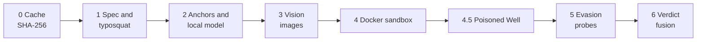

# 19 · Product and Command Reference (landing-page brief)

> Written for the person building SkillSentry's landing page, and for anyone preparing the project for open-source release. Every command, flag, default and sample output here was checked against the source (`skill_sentry_cli/cli.py`, `core/config.py`, `core/version.py`, `install.sh`) or run on a real install. Items that could not be verified on this machine are marked **not verified here**.

**Snapshot:** version 2.0.0 · branch `main` at `c2bb4ab` · generated 2026-11-01.

---

## 19.1 Positioning

| Element | Copy |
|:---|:---|
| Name | SkillSentry (CLI command `skill-sentry-cli`) |
| Tagline | A context-aware firewall for the agent skill supply chain, with "Poisoned Well" active defense |
| One-liner | Audit an agent skill before you install it. The audit runs on your machine. |
| Problem | Agent skills are folders of instructions and scripts that an agent will run and obey. A skill can hide a credential stealer or an instruction that overrides the agent. |
| Promise | One verdict (`SAFE`, `SUSPICIOUS`, `MALICIOUS`), with the file and line that justify it. |
| Differentiator | Fully local analysis. A decoy credential is planted in the sandbox, so a thief reveals itself when it leaves the sandbox. |
| Audience | Developers who install third-party agent skills; teams that gate skills in CI; security reviewers. |

**Hero value props (three):**

1. **Local by default.** The skill, the scan, the local model and the reports never leave your machine. A cloud backend exists but is opt-in.
2. **Active defense.** The Poisoned Well plants fake, intent-matched credentials in the sandbox. If one shows up in outbound traffic, the scan proves exfiltration and exports the attacker's indicators.
3. **Built for CI.** Stable exit codes, SARIF 2.1.0 output, and a versioned JSON contract.

**Verify before publishing:** the README cites outside figures (Snyk "ToxicSkills", ~1,467 malicious skills; a 36% prompt-injection rate; "ClawHavoc"; OWASP AST01). None of these are checked in this repository. Cite them only after confirming the sources and dates.

---

## 19.2 How a scan works



| Stage | Name | What it does |
|:---|:---|:---|
| 0 | Cache | Keys each skill by a SHA-256 of its contents. An unchanged skill is answered from SQLite. |
| 1 | Spec and typosquat | Validates `SKILL.md`. Flags names within edit distance 2 of known skills, case-only variants, and Cyrillic or Greek lookalikes. |
| 2 | Anchors and semantic | Deterministic AST and regex checks, plus the local model's reading of the text. The model cannot override an anchor. |
| 3 | Vision | Scans images for hidden text, such as white-on-white payloads. Up to 3 images are checked, downscaled to 768 px. SVG is read as text. |
| 4 | Sandbox | Runs the declared entrypoint in a container with no network. A masquerade shim, canary files, a DNS sinkhole and a fake HTTP responder watch what it does. |
| 4.5 | Poisoned Well | Tracks planted credentials leaving the sandbox (raw, base64, hex, or split DNS labels). Builds an attacker profile and exports STIX 2.1 indicators. |
| 5 | Evasion | A skill that probes for the sandbox (for example `/.dockerenv` or `/proc/1/cgroup`) is marked `MALICIOUS`. |
| 6 | Verdict | Weighted fusion into a 0–100 risk score, then a verdict. |

**Scoring (default):**

| Signal | Weight |
|:---|:---|
| Anchors | 0.15 |
| Semantic (local model) | 0.20 |
| Vision | 0.20 |
| Sandbox | 0.25 |
| Typosquat bonus | +15 |

| Verdict | Risk score |
|:---|:---|
| `SAFE` | below 30 |
| `SUSPICIOUS` | 30 to 70 |
| `MALICIOUS` | above 70, or a hard-evidence override (confidence 1.00) |

**Guarantees to state on the page:**

- A model finding alone cannot produce `MALICIOUS`. It is capped at `SUSPICIOUS` unless a non-model finding is HIGH or above.
- Quoted evidence from the model is checked against the skill text.
- An error never produces `SAFE`. A degraded scan is shown as `UNSCANNED`, with the reason.

---

## 19.3 Features list (for the features section)

- Eight-stage pipeline with a cache that answers unchanged skills in under 2 seconds (cached-rescan target from the README).
- Typosquat detection against a packaged list of 67 known skill names.
- Sandboxed execution: no network, 512 MB memory, 1 CPU, 128 processes, 60-second default timeout.
- Poisoned Well active defense, with STIX 2.1 export of indicators.
- Sandbox-evasion detection.
- Reports in SARIF 2.1.0, Markdown, JSON and STIX 2.1.
- Local web dashboard: triage table, live scan console, skill detail, cache management.
- A bundled SkillSentry skill (`skillsentry-audit`), so SkillSentry can audit itself with `self-audit`.
- Offline demo mode with seven canned skills, for trying the UI with no Docker or model.
- Guided setup (`setup`) and readiness checks (`doctor`).

---

## 19.4 Install

Each method puts `skill-sentry-cli` on the PATH. Requires Python 3.11 to 3.13.

| Method | Command | Platform | Status |
|:---|:---|:---|:---|
| Install script | `curl -fsSLO https://github.com/EmberPhantom/SkillSentry/releases/latest/download/install.sh && sh install.sh` | Linux, macOS, WSL | `--dry-run` verified (19.14). Full install **not verified here**. |
| Windows script | `powershell -ExecutionPolicy Bypass -File install.ps1` | Windows (no admin rights) | **Not verified here**; the Windows CI job is non-blocking. |
| pipx | `pipx install skill-sentry-cli` | Any with Python 3.11 to 3.13 | The README says a PyPI release is planned. **Confirm the package is live on PyPI before publishing this command.** |
| Docker (server) | `docker run -p 127.0.0.1:8000:8000 ghcr.io/emberphantom/skill-sentry-server:2.0.0` | Any with Docker | Image published by the release workflow. **Not verified here.** The Docker socket is not mounted, so the sandbox is unavailable inside the container by default. |
| From source | `python3.12 -m venv .venv && . .venv/bin/activate && python -m pip install -e ".[dev]"` then `cd ui && npm ci && npm run build` | Any | Used for this document (existing `.venv`, CLI run from it). |

**Install-script options** (`sh install.sh --help`):

| Option | Effect |
|:---|:---|
| `--no-setup` | Install only; do not run `setup` |
| `--upgrade` | Reinstall over an existing install |
| `--version VERSION` | Install a published version, for example `2.0.0` |
| `--wheel PATH` | Install a local wheel. Its checksum is **not** verified. |
| `--dry-run` | Print the download URL and the steps; change nothing |
| `--uninstall` | Remove the command. Scan history and `skillsentry.toml` are kept. |
| `-h`, `--help` | Show help |

Facts for the page: no `sudo`; installs only under the home folder; downloads are checked against `SHA256SUMS`; uses `pipx` if present, otherwise a private virtual environment at `~/.local/share/skill-sentry-cli`, linked from `~/.local/bin`.

**Windows script parameters:** `-NoSetup`, `-Uninstall`, `-DryRun`, `-Version`, `-Wheel`. Installs under `%LOCALAPPDATA%\skill-sentry-cli` and adds it to the user PATH.

**Requirements:**

| Need | For | Check |
|:---|:---|:---|
| Python 3.11 to 3.13 | Everything | `python3.12 --version` |
| Docker, usable without sudo | Sandboxed (full) scans | `docker ps` |
| Ollama with the configured local model | Model analysis | `skill-sentry-cli doctor` names the model to pull |
| Node.js 20+ | Dashboard, source builds only | `node --version` |
| About 8 GB free RAM during a scan | Local model | — |

---

## 19.5 Quickstart (what the user sees)

```bash
skill-sentry-cli setup        # guided; asks before each download or build
skill-sentry-cli doctor       # what is ready, and what is missing
skill-sentry-cli scan path/to/skill
skill-sentry-cli serve        # dashboard at http://127.0.0.1:8000
```

**Real output: offline demo** (run on this machine; no Docker or model needed):

```text
$ skill-sentry-cli scan cloud-sync-pro --demo-mode
SkillSentry 2.0.0 - Fully local analysis · open weights - backend: demo/mock
[X] cloud-sync-pro - MALICIOUS - risk 97 - confidence 1.00
   Canary marker exfiltrated via DNS tunnel to evil-collector.net (scripts/sync.sh:7)
   Poisoned Well: DNS_TUNNELING -> evil-collector.net (marker SKS-7f3a9c21)
```

Exit code: `1`. The demo prints canned results; the banner says `demo/mock`. Do not present demo output as a real scan.

**Real output: readiness check** (run on this machine, Docker stopped):

```text
$ skill-sentry-cli doctor
PASS  model: <configured model> is pulled
PASS  dashboard: built
PASS  database: writable at /home/pranay/.skillsentry/skillsentry.db
WARN  docker: engine not reachable; sandbox scans are unavailable (use --no-sandbox)
PASS  platform: Linux
ready for a full scan
```

The model name is shown as `<configured model>` here; `doctor` prints the name from `skillsentry.toml`. Keep the name out of landing-page copy (see 19.11).

**Real output: a real scan, unsandboxed** (run on this machine):

```text
$ skill-sentry-cli scan fixtures/benign/pdf-summarizer --no-sandbox --no-cache -q
[!] pdf-summarizer - SUSPICIOUS - risk 70 - confidence 0.44
   Declared intent does not match actual behaviour: Summarize PDF documents locally without network access. (SKILL.md:1)
```

This is a **false positive** for a benign fixture, produced with `--no-sandbox`. See 19.12 before using any accuracy claim.

**Sample from the user guide** (sandboxed, previously recorded; **not re-run here** because Docker is not available on this machine):

```text
[OK] pdf-summarizer - SAFE - risk 0 - confidence 0.75
[X] cloud-sync-pro - MALICIOUS - risk 95 - confidence 1.00
   AWS credential file or environment variable referenced (scripts/sync.sh:4)
   Poisoned Well: DNS_TUNNELING -> evil-collector.net (marker SKS-…)
```

---

## 19.6 CLI reference

Entry point: `skill-sentry-cli` (also `python -m skill_sentry_cli`). Running it with no arguments prints help. Shell completion is off.

### Global

| Form | Output | Exit |
|:---|:---|:---|
| `skill-sentry-cli --version` | `SkillSentry 2.0.0 - Fully local analysis · open weights` | 0 |
| `skill-sentry-cli --help` | Command list | 0 |

### Exit codes

| Code | Name | Meaning |
|:---|:---|:---|
| 0 | OK | Every verdict is below the `--fail-on` gate |
| 1 | Verdict | At least one verdict meets the gate |
| 2 | Usage | Bad option, bad value, or missing config file |
| 3 | Operational | Bad path, Docker or database failure, or nothing completed |

Code 4 is defined in the source but **never returned**. Do not document it as a live code.

### `scan`

```text
skill-sentry-cli scan PATH [OPTIONS]
```

`PATH` is one skill folder (contains `SKILL.md`), or a folder whose child folders are skills. Up to 500 skills per run.

| Option | Default | Meaning |
|:---|:---|:---|
| `--format` | `text` | `text`, `json`, `sarif` or `markdown` |
| `--fail-on` | `suspicious` | Exit `1` at this level: `safe` (any non-SAFE), `suspicious`, or `malicious` |
| `-q`, `--quiet` | off | Print the verdict line only |
| `--no-cache` | off | Ignore saved results and scan again |
| `--sandbox` / `--no-sandbox` | sandbox on | `--no-sandbox` never runs the entrypoint; the verdict is weaker |
| `--backend` | `auto` | `auto`, `local`, `cloud`, or `demo`. `demo` is refused unless `SKILLSENTRY_DEV=1` |
| `--timeout` | `60` | Sandbox time limit in seconds, 5 to 600 |
| `--output FILE` | none | Write the rendered report to a file |
| `--sarif-out FILE` | none | Also write a SARIF 2.1.0 file |
| `--report-dir DIR` | none | One Markdown report per skill, plus `summary.md` for folders |
| `--recursive` | off | Also scan skills nested inside a skill folder |
| `--demo-mode` | off | `PATH` is a skill **name** from the canned set: `pdf-summarizer`, `git-helper`, `image-resizer`, `weather-fetch`, `cloud-sync-pro`, `invoice-helper`, `slack-notif-mal`. Any other name exits 2. |

Examples:

```bash
skill-sentry-cli scan fixtures/malicious/cloud-sync-pro
skill-sentry-cli scan skills/ --report-dir reports
skill-sentry-cli scan skills/ --format sarif --sarif-out results.sarif
skill-sentry-cli scan my-skill --format json --output verdict.json
skill-sentry-cli scan my-skill --no-sandbox -q
```

A folder scan ends with a summary line:

```text
Summary: 4 scanned - 4 SAFE, 0 SUSPICIOUS, 0 MALICIOUS, 0 UNSCANNED
```

`INVALID` appears in the summary only when it is non-zero, and then reads `, N INVALID`. A folder with failed children adds `, N failed` and exits 3.

Output icons:

| Icon | Status |
|:---|:---|
| `[OK]` | SAFE |
| `[!]` | SUSPICIOUS |
| `[X]` | MALICIOUS |
| `[?]` | UNSCANNED or INVALID SKILL (see 19.7) |

Each text scan ends with the command that writes its report, for example `Report: skill-sentry-cli export <scan_id> --format markdown -o report.md`.

### `self-audit`

Audits SkillSentry's own bundled skill (`skill_sentry_cli/skill/`).

| Option | Default |
|:---|:---|
| `--format` | `text` |
| `--fail-on` | `suspicious` |
| `-q`, `--quiet` | off |
| `--no-cache` | off |
| `--sandbox` / `--no-sandbox` | sandbox on |
| `--backend` | `auto` |
| `--timeout` | `60` |

No `--output` option. Redirect stdout or use `scan` with `--output` to save a file.

### `init`

Writes a documented `skillsentry.toml`.

| Option | Default | Meaning |
|:---|:---|:---|
| `--path PATH` | `skillsentry.toml` | Destination |
| `--force` | off | Overwrite an existing file |

An existing file without `--force` exits 2. A write failure exits 3. Success prints `wrote <path>`.

### `serve`

Runs the API and dashboard.

| Option | Default | Meaning |
|:---|:---|:---|
| `--host` | `127.0.0.1` | Bind address. Loopback only by default. |
| `--port` | `8000` | 1 to 65535 |
| `--demo-mode` | off | Serve the canned seven-skill store |
| `--speed` | `1.0` | Demo replay speed; `0` is instant. Demo only. |

Prints `SkillSentry 2.0.0 - live mode - http://HOST:PORT` (or `demo mode`). The dashboard is at `/`.

### `cache`

| Subcommand | Options | Output |
|:---|:---|:---|
| `cache stats` | none | `entries: N`, `size_bytes: N`, `hit_rate: 0.000` |
| `cache list` | `--limit N` (1 to 500, default 20) | One line per scan: `scan_id  skill  status  verdict`. Prints `no scans recorded` when empty. |
| `cache clear` | `--older-than 7d` or `12h` | `deleted: N  retained: M`. A bad value exits 2. |

### `export`

Re-renders a stored scan without running it.

```text
skill-sentry-cli export SCAN_ID [--format markdown|sarif|stix] [-o FILE]
```

| Option | Default |
|:---|:---|
| `--format` | `markdown` |
| `-o`, `--output` | print to stdout |

A malformed ID exits 2. An unknown ID exits 2. STIX output carries Poisoned Well indicators, so it is useful only for scans where that stage triggered. Writing a file prints `wrote FILE`.

### `doctor`

Checks what a full scan needs.

| Check | Required | Meaning |
|:---|:---|:---|
| `model` | yes | Local model server reachable and the configured model pulled |
| `dashboard` | yes | Dashboard build present |
| `database` | yes | History database writable |
| `docker` | no | Docker engine reachable |
| `sandbox image` | no | Sandbox image present |
| `platform` | no | Advisory: Linux, macOS, WSL, or native Windows |

Each line is `PASS`, `FAIL` (required and failed), or `WARN` (optional). Exits 3 if a required check fails. Prints `ready for a full scan` when everything required passes.

### `setup`

Guided first-time setup. Asks before every download or build.

| Option | Effect |
|:---|:---|
| `--yes` | Answer yes to every prompt |
| `--skip-model` | Skip the model check and pull |
| `--skip-sandbox` | Skip the sandbox image |

It writes the default configuration if missing. It installs the sandbox image: the published image if one is pinned for this release, otherwise a build from packaged sources. It offers `ollama pull` (default No). It never installs Docker or Ollama. It ends with the `doctor` checks.

### `sandbox build`

Builds `skillsentry-sandbox:local` from the packaged sources. Success prints `built skillsentry-sandbox:local`. Docker failure exits 3.

---

## 19.7 Verdicts and statuses

| Shown as | Meaning | What the user should do |
|:---|:---|:---|
| `SAFE` | Nothing suspicious found | Install after a quick look |
| `SUSPICIOUS` | Needs a human look | Read each cited finding |
| `MALICIOUS` | Hard evidence of hostile behavior | Do not install |
| `UNSCANNED` | A stage did not finish (model, sandbox, or unreadable file). The verdict is shown but not trusted. | Fix the stated reason, then scan again |
| `INVALID SKILL` | `SKILL.md` is malformed (for example, no `name:`). This is a packaging problem, not a malware finding. | Fix the frontmatter, then scan again. It still fails the CI gate. |

**Key facts for the page:**

- A skill with scripts but no `entrypoint:` in `SKILL.md` is `UNSCANNED`, because its scripts were read but never run.
- An `UNSCANNED` skill carries a SUSPICIOUS-tier verdict, so it fails the default `--fail-on suspicious` gate. The user guide documents this, and exit codes follow the verdict.
- Each finding cites a file and line.

---

## 19.8 Configuration

Create the file with `skill-sentry-cli init`. SkillSentry reads `./skillsentry.toml`, or the file named by `SKILLSENTRY_CONFIG`. A named file that does not exist is an error, not a fallback.

**Precedence:** command-line flags, then environment variables, then `skillsentry.toml`, then built-in defaults. Unknown keys are rejected.

**Main sections and defaults** (from `core/config.py`):

| Section | Key | Default |
|:---|:---|:---|
| `[model]` | `backend` | `auto` (`auto`, `local`, `cloud`, `demo`) |
| `[model]` | `ollama_url` | `http://localhost:11434` |
| `[model]` | `ollama_model` | the configured local model (the value is in the generated file) |
| `[model]` | `request_timeout_s` | 180 |
| `[model]` | `image_max_px` | 768 (valid range 256 to 4096) |
| `[sandbox]` | `enabled` | true |
| `[sandbox]` | `base_image` | `skillsentry-sandbox:local` |
| `[sandbox]` | `timeout_s` | 60 (5 to 600) |
| `[sandbox]` | `memory_mb` | 512 |
| `[sandbox]` | `cpus` | 1.0 |
| `[poisoned_well]` | `enabled` | true |
| `[poisoned_well]` | `correlation_window_s` | 10.0 |
| `[scoring]` | `safe_max` / `malicious_min` | 30 / 70 |
| `[scoring]` | `typosquat_bonus` | 15 |
| `[cache]` | `db_path` | `~/.skillsentry/skillsentry.db` |
| `[decision]` | `backend` | `legacy` (optional alternative decision layer; off by default) |

The generated file also documents the decision-layer settings. Treat them as advanced.

**Environment variables:**

| Variable | Use |
|:---|:---|
| `SKILLSENTRY_CONFIG` | Path to the configuration file |
| `SKILLSENTRY_DB` | Path to the history database |
| `SKILLSENTRY_BACKEND` | Default model backend |
| `SKILLSENTRY_NO_SANDBOX=1` | Turn the sandbox off |
| `OLLAMA_HOST` | Address of the Ollama server |
| `SKILLSENTRY_DEV=1` | Allow `--backend demo` for development |
| `SKILL_SENTRY_HOME`, `SKILL_SENTRY_RELEASE_URL` | Installer only: install location, and a mirror for release files |

**State:** `~/.skillsentry/` holds the history database and any reports. Uninstalling keeps it.

---

## 19.9 Outputs and API

**Report formats:**

| Format | Produced by | Notes |
|:---|:---|:---|
| Text | default | Terminal lines |
| JSON | `--format json` | Verdict JSON Contract v1, camel-case fields. Frozen; schema in `schemas/verdict.v1.json`. |
| SARIF 2.1.0 | `--format sarif`, `--sarif-out`, `export --format sarif` | Opens in code-scanning tools. Rule IDs look like `skillsentry/<stage>/<type>`. |
| Markdown | `--format markdown`, `--report-dir`, `export` | Human-readable report |
| STIX 2.1 | `export --format stix` | Indicators from Poisoned Well |

**Local API** (`skill-sentry-cli serve`, loopback by default, **no authentication**):

| Method and path | Purpose |
|:---|:---|
| `POST /scan` | Start a scan (returns 202) |
| `GET /scans` | List stored scans |
| `GET /scan/{id}` | One scan |
| `GET /scan/{id}/verdicts` | Verdicts for a scan |
| `WS /scan/{id}/stream` | Live events: started, progress, finding, override, completed, error, cached |
| `GET /skills/{id}` | Skill detail |
| `GET /skills/{id}/export` | Export a skill's report |
| `GET /cache/stats`, `DELETE /cache` | Cache stats and clear |
| `GET /health`, `GET /meta` | Health and metadata |

Do not expose the server beyond loopback without adding authentication. The server container binds `0.0.0.0` inside its network namespace, so publish the port to `127.0.0.1` only (as in the Docker command in 19.4).

---

## 19.10 CI recipe

The gate is the exit code. The same CLI runs anywhere it can reach Docker and a local model server.

```yaml
name: skill audit
on: [pull_request]
jobs:
  audit:
    runs-on: self-hosted          # needs Docker and the local model server
    steps:
      - uses: actions/checkout@v4
      - uses: actions/setup-python@v5
        with:
          python-version: "3.12"
      - run: python -m pip install skill-sentry-cli     # or install from the release wheel
      - run: skill-sentry-cli sandbox build
      - run: skill-sentry-cli scan skills/ --format sarif --sarif-out results.sarif
      - uses: github/codeql-action/upload-sarif@v3    # not verified here
        if: always()
        with:
          sarif_file: results.sarif
```

**Notes for the page:**

- Hosted runners normally have no Docker and no model server. A hosted run reports `UNSCANNED`, which fails the default gate. Say this plainly.
- Do not use `--fail-on malicious` in CI. It lets SUSPICIOUS and UNSCANNED skills pass.
- The exit codes table: 0 pass, 1 fail the merge, 2 fix the workflow, 3 investigate.
- The planned `skillsentry/scan@v1` GitHub Action **does not exist**. Do not show it as available.

---

## 19.11 Landing-page content kit

**Suggested section order:** hero (tagline, one-liner, install command) → the problem → how a scan works (the pipeline diagram) → Poisoned Well → output (a real sample verdict, SARIF) → install options → CI → open source and local-first → footer.

**Headline options:**

1. Audit an agent skill before it runs on your machine.
2. Know what a skill does before you install it.
3. A firewall for agent skills. Fully local.

**Subheads:**

- Every skill is scanned in a sandbox, checked by a local model, and given one verdict with the file and line behind it.
- Your skills never leave your machine for auditing.

**Terminal block for the hero** (copy exactly; use the real sample from 19.5):

```text
$ skill-sentry-cli scan cloud-sync-pro
[X] cloud-sync-pro - MALICIOUS - risk 95 - confidence 1.00
   AWS credential file or environment variable referenced (scripts/sync.sh:4)
   Poisoned Well: DNS_TUNNELING -> evil-collector.net (marker SKS-…)
```

Use the sandboxed sample only after a sandboxed run confirms it. The demo output from 19.5 is the safe fallback.

**FAQ candidates (answers are accurate to the code):**

- *Does my code leave my machine?* No. Analysis, the local model, and reports stay local. The cloud backend is opt-in and off by default.
- *Is it safe to scan malicious skills?* The entrypoint runs only inside the sandbox, with no network. Canary credentials are fake.
- *Does it run on Windows and macOS?* Linux is the supported platform. Windows and macOS have installers and CI jobs but are **not verified** yet.
- *Can I use it in CI?* Yes, with Docker and a local model server on the runner. See 19.10.
- *What does UNSCANNED mean?* A stage did not finish, so the verdict cannot be trusted. The reason is printed.
- *Why is my skill INVALID SKILL?* Its `SKILL.md` frontmatter is malformed. No behavior was judged.

**Brand and links:**

| Item | Value |
|:---|:---|
| Repository | https://github.com/EmberPhantom/SkillSentry |
| Issues | https://github.com/EmberPhantom/SkillSentry/issues |
| Changelog | https://github.com/EmberPhantom/SkillSentry/blob/main/docs/CHANGELOG.md |
| PyPI (distribution) | `skill-sentry-cli` (confirm live before linking) |
| Sandbox image | `ghcr.io/emberphantom/skillsentry-sandbox` |
| Server image | `ghcr.io/emberphantom/skill-sentry-server` |
| Command | `skill-sentry-cli` |
| License | MIT |
| Badge strings | "Fully local analysis · open weights" (the CLI's own badge); "Poisoned Well" |

**Assets needed:** logo (none in the repo), favicon, screenshots of the dashboard (triage, live console, skill detail), a 30-second demo GIF (a placeholder comment exists in `README.md`), and an icon set for the pipeline.

**Design notes:** the dashboard uses React 18, TypeScript and Vite (`ui/package.json`). The docs mention Tailwind and shadcn/ui, but neither is in `ui/package.json`. The landing page should not claim them unless they are added.

---

## 19.12 Claims to verify before publishing

These are the places where the repository's own claims or first results do not support a strong statement.

| Claim in repo | What was found | Action |
|:---|:---|:---|
| "benign false positives 0/4" (README) | `pdf-summarizer` scored `SUSPICIOUS` (risk 70) in `--no-sandbox` mode on this machine | Re-run the full eval with the sandbox and document the setup. Do not publish "0 false positives" until it holds. |
| "uncached local scan < 90 s" (README target) | A malicious `--no-sandbox --no-cache` scan ran past 120 s on this machine | Measure on a stated machine, then publish the measured number. |
| "cached re-scan < 2 s" (README) | Not measured here | Measure before publishing. |
| Sample output with `risk 95` | Real sandboxed run not reproduced here; the demo shows `risk 97` | Use demo output, or a fresh sandboxed run. |
| `pipx install skill-sentry-cli` | PyPI status not confirmed in this repo | Confirm the package is live. |
| GHCR images | Not pulled here | Confirm before showing the Docker command. |
| Sandbox digest | `data/sandbox_image.json` has an empty digest in source | Source checkouts build the sandbox locally. The published pin exists only after a release. |
| "Windows and macOS supported" | Linux only in the classifier; Windows and macOS are CI-advisory | Say "Linux first; Windows and macOS in progress." |
| Planned features | GitHub Action `skillsentry/scan@v1`, MCP proxy, signed verdicts, `scan --watch` | Do not advertise. `--watch` does not exist. |

---

## 19.13 Open-source and production readiness

**Verified by running (this document's work):**

- `skill-sentry-cli --version` prints `SkillSentry 2.0.0 - Fully local analysis · open weights` (exit 0).
- Every command's `--help` matches the flags in 19.6.
- `doctor` and the offline demo produce the output in 19.5.
- `install.sh --dry-run` prints the expected version, download URL and checksum URL (exit 0). A real install was not run here.
- `tests/unit/test_docs_hygiene.py`: all checks pass in CI (the live count is in the CI run, not in this brief).

**Open-source readiness status** (branch `chore/open-source-readiness`, not pushed):

Done on the branch:

1. **Community and contribution files.** Code of Conduct, support guide, bug and feature templates, a pull request template, CODEOWNERS, Dependabot for pip, npm, Actions and Docker, pre-commit, and `.editorconfig`.
2. **Accuracy fixes.** SARIF links point at `EmberPhantom/SkillSentry`. The install and CLI docs use real commands. Exit code 4 is documented as never returned. The changelog has unique version headings.
3. **Internal material.** Docs 11, 13, 14 and the checklists live under `docs/internal/` with an archive note. The README and CONTRIBUTING no longer name roles.
4. **Model wording.** Public prose says "the local model". A test blocks capitalised model names in the public documents. Identifiers stay where they are functional.
5. **Quality gates.** mypy runs in CI and in `scripts/check.sh` and blocks merges. Coverage has a floor of 86% (measured 88%). Seven modules are on a documented lenient list in `pyproject.toml`.
6. **Container and Node.** Base images are pinned by digest. The server image has a standard-library healthcheck on `/meta`. Node 24 is used everywhere, with a dashboard job in CI.
7. **Release supply chain.** Both images are signed keyless by digest. BuildKit SBOM and max provenance are enabled on both builds. A CycloneDX SBOM is attached to the release. Every workflow action is pinned to a commit SHA.
8. **Governance and policy.** `docs/20-governance.md` covers roles, decisions, release authority, support policy, and a maintainer settings checklist. A non-blocking Python 3.14 job collects evidence. The local API's lack of authentication is documented as a limitation.

Verified on this machine:

- `scripts/check.sh` passes end to end: ruff, mypy, 601 tests with 88% coverage, the schema check, and the demo smoke test.
- The server image builds with the pinned digests. It runs as uid 10001, reports healthy, serves `/meta` on loopback, and mounts no Docker socket.
- The SBOM steps were run locally against a built wheel and produced 40 components.
- `actionlint` passes on both workflows. Every `uses:` is pinned to a 40-character SHA.

Still open (cannot be finished in this repository):

- **Repository settings.** A maintainer applies the checklist in [docs/20 §20.5](20-governance.md#205-maintainer-settings-checklist). Check the branch-protection status names against a real CI run before enforcing them.
- **Release path.** The image signing, image SBOM, provenance, and wheel SBOM steps run only on a real tag. Test them with a release candidate and the commands in [docs/17](17-release-process.md#verify-a-release) before a final release.
- **Publication.** PyPI and GHCR publication are not confirmed from this repository.
- **Accuracy.** The benign false-positive and latency targets have not been re-measured for the current release (see 19.12).
- **Local API authentication.** Documented as a limitation. Team-server authentication is a proposal, not implemented.
- **Strict typing.** Tighten the lenient modules in `pyproject.toml` one at a time.
- **Model name in identifiers.** Config defaults, the frozen contract field `gemma_badge`, and class names still contain the name by design. Renaming the contract field belongs to a future major version.
- **Assets.** A logo, screenshots, and the 30-second demo GIF do not exist yet.
- **Version.** The examples in this brief were captured on 2.0.0. `main` is now 2.1.0rc1.

**Documentation cleanup:**

- `docs/CHANGELOG.md` keeps old `skillsentry` and `skill-sentry` command names in earlier entries. They are historical, so leave them.
- The docs index lists every document in order.

---

## 19.14 Verification log

| Check | Result |
|:---|:---|
| `skill-sentry-cli --version` | Matches 19.6 |
| `--help` for root, `scan`, `cache`, `sandbox`, `self-audit`, `init`, `serve`, `export`, `doctor`, `setup` | Matches 19.6 |
| `scan cloud-sync-pro --demo-mode` | Exit 1; output in 19.5 |
| `scan fixtures/benign/pdf-summarizer --no-sandbox --no-cache -q` | Exit 1, `SUSPICIOUS` (see 19.12) |
| `scan fixtures/malicious/cloud-sync-pro --no-sandbox --no-cache -q` | Did not finish within 120 s; stopped |
| `doctor` | Exit 0; Docker warning; output in 19.5 |
| `install.sh --dry-run` | Exit 0; prints version 2.0.0 and the release URLs |
| `pytest tests/unit/test_docs_hygiene.py` | all checks pass (see CI) |
| Sandboxed scan | **Not run**: Docker unreachable from this session |
| `install.sh` full install | **Not run** |
| `tests/unit/test_user_guide.py` | Re-run after this change; it checks the user guide, not this file |

---

*Powered by a local model · open weights.*
