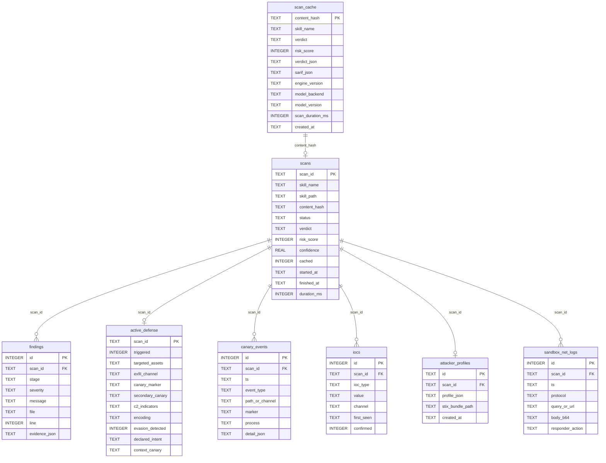

# 3 · Database

> Persistence design for SkillSentry: the incremental scan cache, scan history, findings, Poisoned Well telemetry (canary events, IOCs, attacker profiles), and the team-server Postgres variant.

---

## 3.1 Overview & Design Goals

SkillSentry is **local-first**: the single source of truth on a developer machine is one SQLite file. The team-server deployment (§3.9) runs the same logical schema on Postgres.

| Goal | Mechanism |
|:---|:---|
| Cached re-scan **< 2 s** | `scan_cache` keyed by content hash; verdict + full SARIF stored inline (single-row read) |
| Correct invalidation | Cache row stores `engine_version`, `model_backend`, `model_version`; any change ⇒ miss |
| Full evidence trail | Every finding, canary event, DNS/HTTP log line, and IOC persisted per scan |
| Attacker profiling | `attacker_profiles` + `iocs` tables feed STIX export and the IOC graph UI |
| Zero external services | SQLite (WAL mode) for local; no network dependency |
| Privacy | DB never leaves the machine; no telemetry tables exist by design |

**File locations (local mode):**

```text
~/.skillsentry/
 ├── skillsentry.db          # SQLite (WAL mode)
 ├── reports/                # Exported SARIF / Markdown / STIX files
 │    └── <scan_id>/…
 └── skillsentry.toml        # User config (see 07-cli-reference.md)
```

## 3.2 Content Hashing (Cache Key) — Spec

The cache key is a **SHA-256 digest of the normalized skill directory**, computed by `core/cache/hash_utils.py`:

1. Recursively walk the skill directory; **exclude** `.git/`, `__pycache__/`, `*.pyc`, `.DS_Store`, and any path matching `.skillsentryignore`.
2. Sort entries by relative POSIX path (byte-order) for determinism.
3. For each entry, feed the hasher: `path + "\0" + file_mode_bits + "\0" + sha256(file_bytes) + "\n"`.
4. Final key: `sha256(concatenation)` → lowercase hex, 64 chars.

Properties: any content, rename, permission-bit, or add/delete change alters the hash; hashing is stable across machines and filesystems; cost is negligible (< 50 ms for typical skills).

## 3.3 Entity–Relationship Diagram



## 3.4 Schema DDL (SQLite)

```sql
PRAGMA journal_mode = WAL;
PRAGMA foreign_keys = ON;

-- Schema bookkeeping ------------------------------------------------------
CREATE TABLE IF NOT EXISTS schema_meta (
    key   TEXT PRIMARY KEY,
    value TEXT NOT NULL
);
-- e.g. ('schema_version','1'), ('engine_version','2.0.0')

-- Stage 0: incremental cache ---------------------------------------------
CREATE TABLE IF NOT EXISTS scan_cache (
    content_hash     TEXT PRIMARY KEY,            -- SHA-256 of normalized dir (§3.2)
    skill_name       TEXT NOT NULL,
    verdict          TEXT NOT NULL CHECK (verdict IN ('SAFE','SUSPICIOUS','MALICIOUS')),
    risk_score       INTEGER NOT NULL CHECK (risk_score BETWEEN 0 AND 100),
    confidence       REAL,
    verdict_json     TEXT NOT NULL,               -- frozen Verdict Contract v1
    sarif_json       TEXT NOT NULL,               -- full SARIF 2.1.0 report
    active_defense_json TEXT,                     -- activeDefense block (nullable)
    engine_version   TEXT NOT NULL,               -- invalidation key part 1
    model_backend    TEXT NOT NULL,               -- 'ollama' | 'gemini-api' | 'demo'
    model_version    TEXT NOT NULL,               -- e.g. 'gemma-4-e4b-q4' — part 2
    scan_duration_ms INTEGER,
    created_at       TEXT NOT NULL DEFAULT (strftime('%Y-%m-%dT%H:%M:%fZ','now'))
);

-- Scan history -------------------------------------------------------------
CREATE TABLE IF NOT EXISTS scans (
    scan_id      TEXT PRIMARY KEY,                -- uuid4
    skill_name   TEXT NOT NULL,
    skill_path   TEXT NOT NULL,
    content_hash TEXT NOT NULL,
    status       TEXT NOT NULL DEFAULT 'running'
                 CHECK (status IN ('queued','running','completed','failed','cached-hit')),
    verdict      TEXT,
    risk_score   INTEGER,
    confidence   REAL,
    cached       INTEGER NOT NULL DEFAULT 0,      -- 1 if served from scan_cache
    backend      TEXT,                            -- model backend actually used
    started_at   TEXT NOT NULL,
    finished_at  TEXT,
    duration_ms  INTEGER,
    error        TEXT                             -- failure reason, if status='failed'
);
CREATE INDEX IF NOT EXISTS idx_scans_hash    ON scans(content_hash);
CREATE INDEX IF NOT EXISTS idx_scans_started ON scans(started_at DESC);

-- Findings (one row per SARIF result) --------------------------------------
CREATE TABLE IF NOT EXISTS findings (
    id            INTEGER PRIMARY KEY AUTOINCREMENT,
    scan_id       TEXT NOT NULL REFERENCES scans(scan_id) ON DELETE CASCADE,
    stage         TEXT NOT NULL
                  CHECK (stage IN ('cache','spec','typosquat','deterministicAnchor',
                                   'semantic','vision','sandbox','poisonedWell',
                                   'evasion','verdict')),
    severity      TEXT NOT NULL CHECK (severity IN ('low','medium','high','critical','note')),
    message       TEXT NOT NULL,
    file          TEXT,                           -- relative path in skill package
    line          INTEGER,                        -- 1-based; NULL for network events
    evidence_json TEXT                            -- {"code": "...", "c2": "...", ...}
);
CREATE INDEX IF NOT EXISTS idx_findings_scan ON findings(scan_id);

-- Poisoned Well summary (1:1 with scan) ------------------------------------
CREATE TABLE IF NOT EXISTS active_defense (
    scan_id             TEXT PRIMARY KEY REFERENCES scans(scan_id) ON DELETE CASCADE,
    triggered           INTEGER NOT NULL DEFAULT 0,
    targeted_assets     TEXT,                     -- JSON array
    exfil_channel       TEXT CHECK (exfil_channel IN
                          ('DNS_TUNNELING','HTTP_POST','RAW_SOCKET',NULL)),
    canary_marker       TEXT,                     -- 'SKS-<8hex>'
    secondary_canary    TEXT,
    c2_indicators       TEXT,                     -- JSON array of domains/IPs
    encoding            TEXT,                     -- 'base64' | 'hex' | 'raw' | ...
    sandbox_evasion_detected INTEGER NOT NULL DEFAULT 0,
    declared_intent     TEXT,
    actual_behavior     TEXT,
    context_canary      TEXT,                     -- 'AWS' | 'GITHUB' | 'SLACK' | 'SSH' | 'GENERIC'
    ioc_export_path     TEXT                      -- reports/<scan_id>/stix-bundle.json
);

-- Canary / deception telemetry (append-only event log) ----------------------
CREATE TABLE IF NOT EXISTS canary_events (
    id              INTEGER PRIMARY KEY AUTOINCREMENT,
    scan_id         TEXT NOT NULL REFERENCES scans(scan_id) ON DELETE CASCADE,
    ts              TEXT NOT NULL,                -- ISO-8601 with ms, sandbox clock
    event_type      TEXT NOT NULL CHECK (event_type IN
                      ('canary_seeded','canary_read','fake_served','probe_detected',
                       'exfil_raw','exfil_decoded','marker_matched','secondary_served')),
    path_or_channel TEXT,                         -- file path, 'dns', or 'http'
    marker          TEXT,                         -- SKS-<8hex> if applicable
    process         TEXT,                         -- pid/comm inside sandbox
    detail_json     TEXT
);
CREATE INDEX IF NOT EXISTS idx_canary_scan_ts ON canary_events(scan_id, ts);

-- Raw sandbox network log (DNS sinkhole + fake HTTP responder) --------------
CREATE TABLE IF NOT EXISTS sandbox_net_logs (
    id               INTEGER PRIMARY KEY AUTOINCREMENT,
    scan_id          TEXT NOT NULL REFERENCES scans(scan_id) ON DELETE CASCADE,
    ts               TEXT NOT NULL,
    protocol         TEXT NOT NULL CHECK (protocol IN ('dns','http')),
    query_or_url     TEXT NOT NULL,               -- qname or method+URL
    body_b64         TEXT,                        -- HTTP body / DNS payload, base64
    responder_action TEXT                         -- 'NXDOMAIN-fake-200', '200+secondary', ...
);
CREATE INDEX IF NOT EXISTS idx_net_scan_ts ON sandbox_net_logs(scan_id, ts);

-- Confirmed indicators of compromise ----------------------------------------
CREATE TABLE IF NOT EXISTS iocs (
    id          INTEGER PRIMARY KEY AUTOINCREMENT,
    scan_id     TEXT NOT NULL REFERENCES scans(scan_id) ON DELETE CASCADE,
    ioc_type    TEXT NOT NULL CHECK (ioc_type IN
                  ('domain-name','ipv4-addr','url','hostname-pattern')),
    value       TEXT NOT NULL,
    channel     TEXT,                             -- where observed: dns/http
    first_seen  TEXT NOT NULL,
    confirmed   INTEGER NOT NULL DEFAULT 0,       -- 1 ⇔ canary marker correlated
    UNIQUE (scan_id, ioc_type, value)
);
CREATE INDEX IF NOT EXISTS idx_iocs_value ON iocs(value);

-- Attacker profiles (STIX-ready) --------------------------------------------
CREATE TABLE IF NOT EXISTS attacker_profiles (
    id              TEXT PRIMARY KEY,             -- uuid4
    scan_id         TEXT NOT NULL UNIQUE REFERENCES scans(scan_id) ON DELETE CASCADE,
    profile_json    TEXT NOT NULL,                -- targeted, channel, C2, encoding...
    stix_bundle_path TEXT,                        -- reports/<scan_id>/stix-bundle.json
    created_at      TEXT NOT NULL DEFAULT (strftime('%Y-%m-%dT%H:%M:%fZ','now'))
);
```

## 3.5 Cache Semantics (Stage 0)

**Lookup (must complete < 2 s including hashing):**

```sql
SELECT verdict_json, sarif_json
FROM scan_cache
WHERE content_hash = :hash
  AND engine_version = :engine_version
  AND model_version  = :model_version;
```

**Rules:**

1. A hit requires **all three** keys to match: content hash, engine version, model version. Backend identity (`ollama` vs `gemini-api`) is recorded but a hit from either backend is acceptable *if* the user has not pinned a backend in config (`cache.backend_strict = true` opts into strict matching).
2. On hit, a `scans` row is still inserted with `status='cached-hit'`, `cached=1` — history stays complete and the UI can show the ⚡ indicator.
3. On miss, the full pipeline runs and the verdict engine **upserts** `scan_cache` in the same transaction that writes `findings` / `active_defense`.
4. `--no-cache` bypasses read *and* write (used for evaluating model upgrades).
5. Malicious verdicts are cached like any other — re-scanning a known-bad skill is instant, which matters for registry cron re-scans.
6. **Static-only scans bypass the cache entirely** (read and write). A `--no-sandbox` verdict lacks execution and Poisoned Well evidence; reusing it for a later full scan would poison the cache with an under-evidenced `SAFE`.
7. **A full scan with a non-default analysis mode also bypasses the cache.** A different `--timeout` value or a differing Poisoned Well setting can change the evidence, but those modes are not part of the current cache key; bypassing prevents a cross-mode hit.
8. **Degraded scans are never cached.** If any stage is degraded or errored (Docker unavailable, model unavailable, parser/storage degradation), the scan completes with an explicit finding but does not write a reusable cache row.
9. Cache write failures never turn a verdict into a clean pass: the scan history is marked failed/degraded and the CLI/API surfaces an operational error.

**Invalidation matrix:**

| Change | Effect |
|:---|:---|
| Any file in the skill changes | New `content_hash` ⇒ miss |
| SkillSentry engine upgrade | `engine_version` mismatch ⇒ miss (all rows stale) |
| Ollama model re-pull / new quant | `model_version` mismatch ⇒ miss |
| Fusion weights config change | Treated as engine-version bump (weights hash folded into `engine_version`) |
| Manual | `skill-sentry-cli cache clear [--older-than 30d]` |

## 3.6 Write Paths per Stage

| Stage | Tables written |
|:--|:---|
| 0 Cache | `scans` (row created, `status='running'` or `'cached-hit'`) |
| 1 Spec/Typosquat | `findings` (stage `spec` / `typosquat`) |
| 2 Anchors + Semantic | `findings` (stage `deterministicAnchor`, `semantic`) |
| 3 Vision | `findings` (stage `vision`, with bbox in `evidence_json`) |
| 4 Sandbox | `findings` (stage `sandbox`), `sandbox_net_logs`, `canary_events` (`canary_seeded`, `canary_read`, `probe_detected`) |
| 4.5 Poisoned Well | `canary_events` (`fake_served`, `exfil_*`, `marker_matched`, `secondary_served`), `iocs`, `attacker_profiles`, `active_defense` |
| 5 Evasion | `findings` (stage `evasion`), `active_defense.sandbox_evasion_detected=1` |
| 6 Verdict | `scans` (finalized), `scan_cache` (upsert), report files on disk |

All writes for one scan are wrapped so a crash mid-scan leaves `status='failed'` with a partial evidence trail — never a phantom cache entry.

## 3.7 Example Queries

```sql
-- Triage table backing query (Screen 3)
SELECT s.skill_name, s.verdict, s.risk_score, s.cached,
       (SELECT message FROM findings f
         WHERE f.scan_id = s.scan_id
         ORDER BY CASE f.severity WHEN 'critical' THEN 0 WHEN 'high' THEN 1
                  WHEN 'medium' THEN 2 ELSE 3 END
         LIMIT 1) AS key_finding
FROM scans s
WHERE s.status IN ('completed','cached-hit')
ORDER BY s.risk_score DESC;

-- Poisoned Well timeline (Tab D4)
SELECT ts, event_type, path_or_channel, marker, process
FROM canary_events WHERE scan_id = :id ORDER BY ts;

-- Community blocklist feed candidate: confirmed IOCs across scans
SELECT ioc_type, value, COUNT(*) AS hits, MAX(first_seen) AS last_seen
FROM iocs WHERE confirmed = 1
GROUP BY ioc_type, value ORDER BY hits DESC;
```

## 3.8 Retention & Privacy

- **Local mode:** data belongs to the user; nothing is uploaded anywhere. Default retention is unlimited; `skill-sentry-cli cache clear --older-than 90d` and `DELETE FROM scans WHERE started_at < …` (cascading) are the pruning tools.
- **Sensitive material:** canary credentials are *fake by construction* (marker `SKS-…`, `-fake` suffixes) so storing them is safe. HTTP bodies from the sandbox may contain fragments of real skill data — they are stored base64 in `sandbox_net_logs` and are only ever read by the local UI/exports.
- **Exports** (SARIF/STIX/Markdown) are written to `~/.skillsentry/reports/<scan_id>/` and are user-initiated only.

## 3.9 Team-Server Variant (Postgres) — Spec (proposed)

The self-hosted topology ([09-deployment-and-production.md](../operations/deployment.md)) replaces SQLite with Postgres using the **same logical schema**, plus:

| Addition | Purpose |
|:---|:---|
| `scan_sources` table (`ci_run_id`, `repo`, `ref`, `pr_number`) | Attribute scans to GitHub Action runs / PR gates |
| Row-level timestamps with time zone | Multi-machine aggregation |
| Read-replica-friendly queries | Dashboard on a $12 DigitalOcean droplet reads only |
| `iocs` global uniqueness (`UNIQUE (ioc_type, value)`) + `seen_in_scans` counter | Feeds the signed community blocklist |

Migration path: `sqlite_store.py` speaks a thin repository interface (`get_cached`, `record_scan`, `append_event`, …); the Postgres implementation swaps behind the same interface — no pipeline code changes.

## 3.10 Migrations

- `schema_meta.schema_version` is checked at startup; migrations are sequential SQL files `migrations/0001_init.sql`, `0002_….sql`, applied in a transaction.
- **Verdict schema is versioned separately** (contract v1). If the verdict JSON contract ever bumps, cached rows with an older contract are ignored on read and rewritten on next scan (no destructive migration of evidence tables).
- Downgrade policy: SkillSentry refuses to open a DB with a *newer* `schema_version` than the binary supports (fail closed, with a clear upgrade message).

---

*Next: [04-security.md](security.md) — threat model, sandbox hardening, and SkillSentry's own security posture.*
